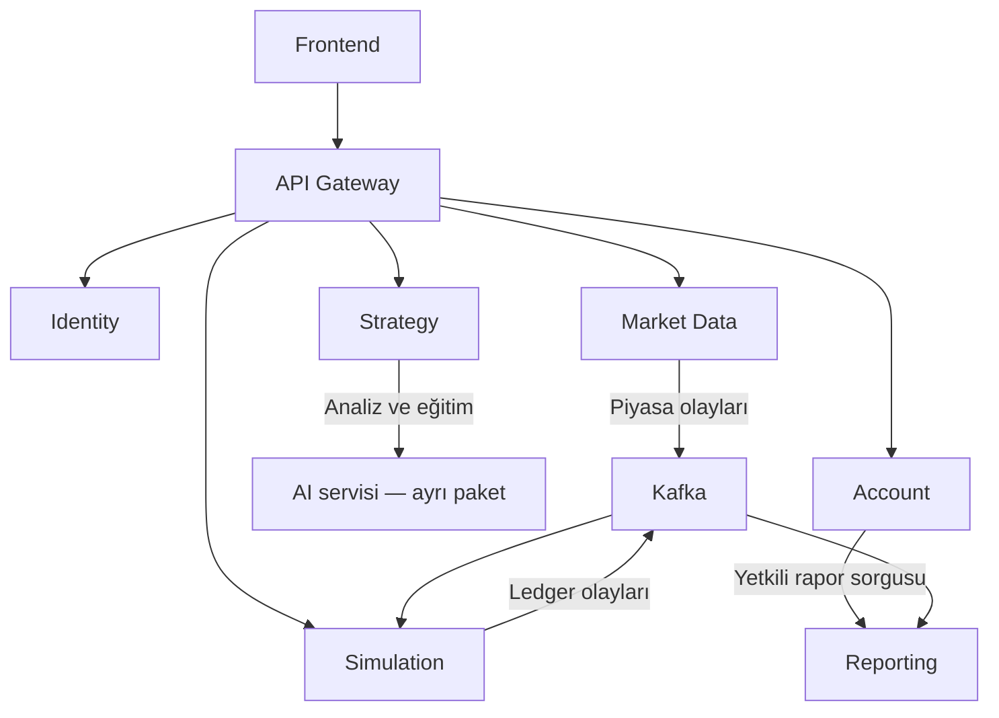
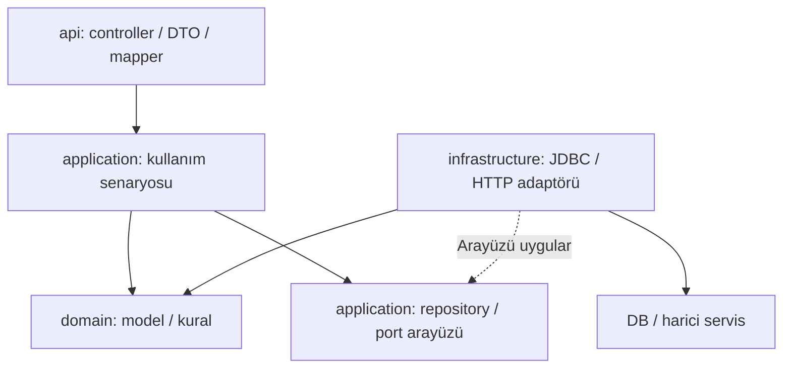
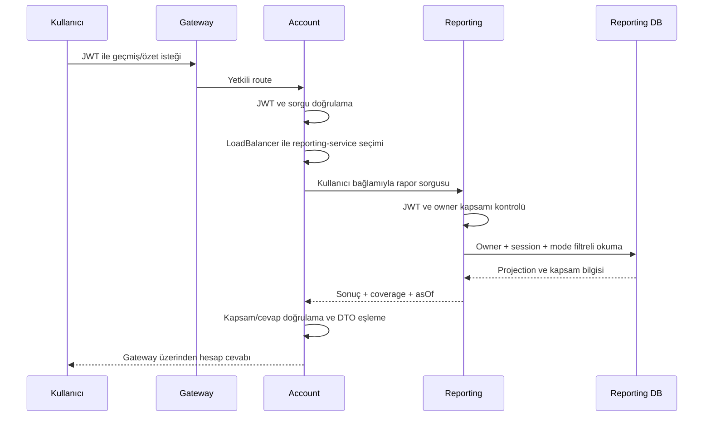
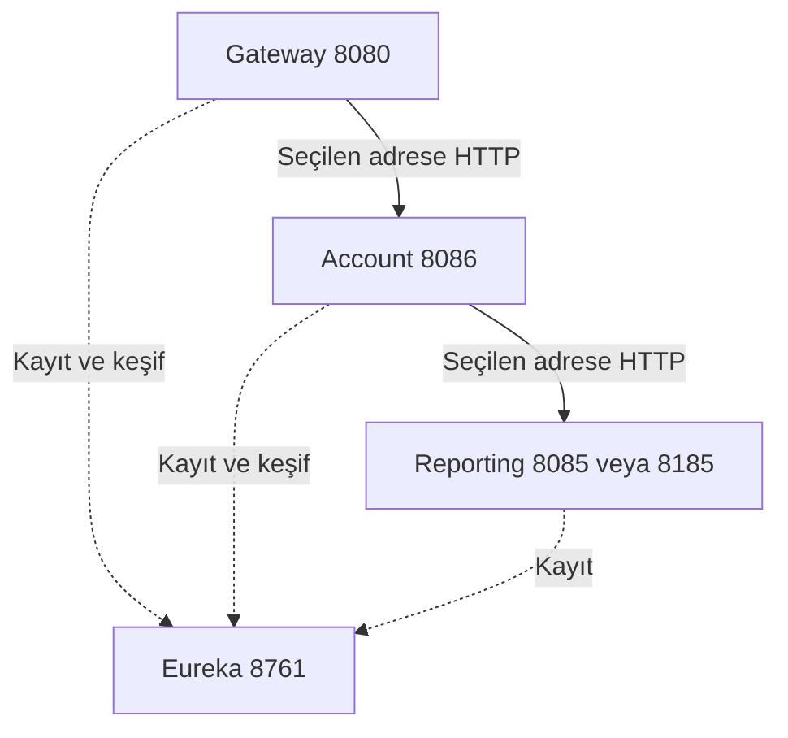

# CryptoLab — Backend hedef mimarisi ve paket yapısı

14 Ekim 2026 · Tek dosyalık mimari rehber · Revizyon 4 / ACC-01 / DISC-01 ile uyumlu

> Bu belge backend tamamlandığında oluşacak yapıyı gösterir. Servis sınırları, paketler, veri sahipliği ve çalışma akışları birlikte anlatılır. “Hedef yapı” ifadesi bütün kodların bugün yazıldığı veya entegrasyon testlerinin geçtiği anlamına gelmez. Mevcut ders örnekleri ile tamamlanacak sorumluluklar aşağıda ayrılmıştır.

## 1. Bu backend hangi mimariyi kullanıyor?

**Eureka ile servis keşfi kullanan mikroservis mimarisi; her iş servisinin içinde dört katmanlı, port/adaptör yaklaşımı kullanan bir yapı.** Maven multi-module düzeni bütün backend modüllerini tek depoda yönetir. Her çalışan servisin kendi Spring Boot başlangıç sınıfı, ayarı ve dağıtım birimi vardır. Aynı Maven parent altında olmak servisleri tek JVM uygulamasına dönüştürmez.

Servis içindeki dört ana paket: `api`, `application`, `domain`, `infrastructure`. Controller, DTO, mapper, service, repository, config ve exception bu paketlerin altında görevlerine göre yerleşir. Bir sınıfın konumu yalnız adına göre değil, sahip olduğu sorumluluğa göre belirlenir.

| Mimari karar | Bu projedeki karşılığı |
|---|---|
| İş alanına göre servis ayrımı | Identity, Market Data, Simulation, Strategy, Reporting ve Account |
| Servis keşfi | Eureka registry + Spring Cloud LoadBalancer; HTTP trafiği registry’den geçmez |
| Tek API giriş noktası | API Gateway; frontend servis portlarını doğrudan kullanmaz |
| Veri sahipliği | Her kalıcı iş servisi kendi veritabanını yönetir; servisler arası SQL/join yok |
| Finansal tutarlılık | Wallet, order, position, risk ve ledger aynı Simulation sınırında |
| Asenkron veri yayılımı | Kafka, transactional outbox ve idempotent consumer/projection |
| Okuma modeli ayrımı | Reporting kalıcı rapor modeli; Account kullanıcıya yönelik okuma API'si |
| Teknik bağımlılıkların izolasyonu | Repository/client/cache adaptörleri infrastructure altında |
| Paylaşılan saf hesap | finance-core; ortak entity veya ortak iş repository'si yok |

Burada okuma/yazma ayrımı vardır; tüm sistemi otomatik olarak tam event-sourcing mimarisi kabul etme. Ledger finansal denetim kaynağıdır; her tablonun yalnız event replay ile üretildiği varsayılmaz.

## 2. Servislerin birbirine bağlanması



Reporting’in doğrudan rapor/export API’leri de Gateway üzerinden erişilir; şemada Account üzerinden okuma yolu öne çıkarılmıştır. Şema ana iş bağlantılarını gösterir; servisler arası bütün endpoint'lerin listesi değildir. Kafka okları farklı olay türlerini temsil eder. AI servisinin eğitim/model veritabanı backend servislerine taşınmaz. AI önerisi doğrudan bakiye değiştirme veya kullanıcı onayını atlama yetkisi vermez.

### Modüller, portlar ve veritabanları

| Maven modülü | Port | Sahip olduğu iş | Kalıcılık |
|---|---:|---|---|
| `discovery-server` | 8761 | Eureka servis kaydı ve keşif | İş DB’si yok |
| `api-gateway` | 8080 | Route, CORS, giriş sınırları ve proxy | İş veritabanı yok |
| `identity-service` | 8081 | Kullanıcı, giriş, parola, JWT ve refresh yaşam döngüsü | `identity_db` |
| `market-data-service` | 8082 | Enstrüman kataloğu, piyasa verisi, veri kapsamı ve tarihsel veri erişimi | `market_db` |
| `simulation-service` | 8083 | Paper session, emir, pozisyon, cüzdan, risk, ledger ve replay | `simulation_db` |
| `strategy-service` | 8084 | Analiz, AI önerisi, tarama ve eğitim facade'ı | `strategy_db` |
| `reporting-service` | 8085 | Kalıcı işlem geçmişi, projection, rapor ve export | `reporting_db` |
| `account-service` | 8086 | Hesabım ekranının işlem geçmişi ve toplam kâr/zarar API'si | Kendi DB'si yok; Reporting üzerinden okur |
| `finance-core` | — | Saf finans hesapları ve değer tipleri | DB/ağ/framework yok |
| `test-support` | — | Ortak test fixture ve entegrasyon yardımcıları | Üretim uygulaması değil |

**Toplam: on Maven modülü, sekiz çalışan Spring Boot süreci (yedi uygulama + bir Eureka server).** Geliştirmede veritabanları aynı PostgreSQL sunucusunda bulunabilir; yine de servis başına ayrı DB, kullanıcı ve erişim yetkisi korunur. Başka servisin tablolarına doğrudan erişim yapılmaz.

## 3. Proje dizini

Aşağıdaki girintiler klasör ilişkisini gösterir. Bu görünüm backend kapsamındadır; frontend ve AI kendi proje alanlarında kalır.

```text
backend/
    pom.xml
    discovery-server/
    api-gateway/
    identity-service/
    market-data-service/
    simulation-service/
    strategy-service/
    reporting-service/
    account-service/
    finance-core/
    test-support/
```

Her çalışan serviste temel kaynak yerleşimi:

```text
<service-module>/
    pom.xml
    src/
        main/
            java/
                com/cryptolab/<service>/
                    <Service>Application.java
                    api/
                    application/
                    domain/
                    infrastructure/
            resources/
                application.properties
                application-dev.properties
                application-test.properties
                db/migration/
        test/
            java/
                com/cryptolab/<service>/
            resources/
```

Profil dosyaları yalnız ihtiyaç varsa açılır. `db/migration` yalnız DB sahibi servislerde bulunur; Account, Gateway ve discovery-server için gereksiz migration dizini oluşturulmaz. Teste özel ayarlar `src/test/resources` altında da tutulabilir. Aynı profil ayarının farklı konumlarda çelişen kopyalarını bırakma.

Örnek kök `com.cryptolab`dır. Mevcut projen `com.crypto` kullanıyorsa kendi kökünü bütün modüllerde tutarlı kullan; bu belgeyi uygulamak için groupId veya çalışan package adlarını değiştirmek zorunda değilsin. Başlangıç sınıfı servis paketinin kökünde yer alır, diğer servis paketlerini geniş component scan ile taramaz.

## 4. Servis içi paket ağacı

Bu ağaç ihtiyaç duyulabilecek paketlerin ortak sözlüğüdür. Her serviste her klasörü açma; örneğin salt okuma yapan Account'ta command veya kalıcılık repository'si zorunlu değildir.

```text
com.cryptolab.<service>
    <Service>Application
    api
        controller
        dto
            request
            response
        mapper
        exception
        validation
    application
        command
        service
        repository
        port
        security
        replay
    domain
        model
        service
        exception
    infrastructure
        config
        repository
        client
            fixture
        mapper
        messaging
        cache
        ratelimit
        security
        streaming
        artifact
        export
```

### Sınıfı nereye koyacağım?

| Paket | Sorumluluk | Örnek | Buraya koyma |
|---|---|---|---|
| `api.controller` | HTTP isteğini alır, principal'ı çıkarır ve kullanım senaryosunu çağırır | `AccountController`, `OrderController` | SQL, ücret hesabı |
| `api.dto.request` | Kabul edilen dış alanlar ve biçim doğrulaması | `LoginRequest`, `SubmitOrderRequest` | Sunucunun hesaplaması gereken PnL, yetki veren ownerId |
| `api.dto.response` | Dış JSON sözleşmesi | `AccountSummaryResponse`, `ApiError` | DB entity, parola hash'i |
| `api.mapper` | Request → command, sonuç → response | `OrderMapper`, `AccountMapper` | DB sorgusu, yetki kararı |
| `api.exception` | Hataları güvenli HTTP durumuna ve hata zarfına çevirir | `AccountErrors`, `ApiErrors` | Ham SQL/stack trace çıktısı |
| `api.validation` | Giriş sözleşmesine özel doğrulama | `ContractGate` | Finansal risk politikası |
| `application.command` | Kullanım senaryosu girdisi | `SubmitOrderCommand` | Servlet veya HTTP response |
| `application.service` | İşlem sırası, transaction, sahiplik kontrolünün orkestrasyonu | `SubmitOrder`, `AccountQueryService` | JDBC, provider JSON parsing |
| `application.repository` | Kalıcılık ihtiyacını tanımlayan arayüz | `SessionRepository` | SQL veya JdbcTemplate |
| `application.port` | Harici yetenek sözleşmesi | `ModelClient`, `AccountReportReader` | Somut HTTP/Redis kodu |
| `application.security` | Bu projedeki saf auth yardımcıları | `Crypto` | SecurityFilterChain |
| `application.replay` | Tarihsel çalıştırma orkestrasyonu | `ReplayRunner`, `VirtualClock` | Canlı session'a yazım |
| `domain.model` | İş kavramları ve değer tipleri | `ExecutionPlan`, `Journal`, `AccountSummary` | Spring/JDBC annotation'ları |
| `domain.service` | Saf iş kararları ve hesap politikaları | `ExecutionGate`, `RiskDecision` | DB/ağ erişimi |
| `domain.exception` | HTTP'den bağımsız iş hata kodları | `BusinessException`, `AccountFailure` | HttpStatus veya ResponseEntity |
| `infrastructure.repository` | Repository portunun JDBC uygulaması ve veri eşlemesi | `JdbcSessionRepository` | Başka servisin DB erişimi |
| `infrastructure.config` | Bean, istemci, güvenlik ve serialization ayarları | `AccountSecurityConfig`, `EngineConfig` | İşlem açma kararı |
| `infrastructure.client` | HTTP/provider adaptörü; süre ve boyut sınırları | `HttpAccountReportReader` | Finansal otorite |
| `infrastructure.mapper` | Dış provider formatını normalize eder | `BinanceMetadataDecoder` | Controller response eşlemesi |
| `infrastructure.messaging` | Kafka listener ve outbox yayımı | `MarketListener`, `OutboxPublisher` | Onayı atlayan emir üretimi |
| `infrastructure.cache` | Redis TTL ve cache erişimi | `SnapshotCache` | Kalıcı cüzdan kaydı |
| `infrastructure.security` | Token imzalama gibi teknik güvenlik adaptörü | `AccessTokens` | Kullanıcı işlem geçmişi |
| `infrastructure.ratelimit` | Local/Redis limiter | `RedisLoginLimiter` | Login kullanım senaryosunun tamamı |
| `infrastructure.streaming` | SSE bağlantısı ve sınırlı buffer | `SseRing` | Para hesabı |
| `infrastructure.artifact` / `export` | Dosya doğrulama ve dışa aktarma | `ArtifactReader`, `CsvCell` | Model eğitimi veya risk kararı |

### DTO, model ve entity aynı şey mi?

**Hayır.** Request DTO dış isteği, command uygulama girdisini, domain model iş kavramını, response DTO dış cevabı temsil eder. Veritabanı satırının yapısı bunlardan ayrı bir konudur. Mevcut örneklerde JDBC kullanıldığı için her tabloya JPA `@Entity` eklenmez. İleride bilinçli bir JPA geçişi yapılırsa persistence entity'leri infrastructure altında tutulur; bu belge mevcut JDBC yaklaşımını değiştirmez.

Repository arayüzünün `application.repository` altında olması, repository kodunun orada çalıştırıldığı anlamına gelmez. SQL adaptörü `infrastructure.repository` içindedir ve arayüzü uygular. Mapper yalnız veri biçimi dönüştürür; hesap veya yetkilendirme yapmaz. Her service için mekanik olarak interface + `ServiceImpl` oluşturmak gerekmez.

## 5. Katman bağımlılıkları ve çağrı akışı



Bu şema **kaynak kod bağımlılıklarını** gösterir. Çalışma anında Spring arayüze somut adaptörü bağlar. Application service `Jdbc...Repository` veya `Http...Client` import etmez; arayüzü kullanır. Domain, dış katmanları veya Spring'i tanımaz. Security config gibi giriş adaptörü yapılandırmaları API hata zarfını kullanabilir; bu domain bağımsızlığını değiştirmez.

Örnek istek sırası: JWT doğrulama → controller → request/command eşlemesi → application service → domain kontrolü ve repository portu → JDBC adaptörü → sonuç/response eşlemesi. HTTP annotation'ı olmayan saf domain testleri Spring context başlatmadan çalışır.

## 6. Servis bazında sınıf ve paket görünümü

Aşağıdaki tablolar güncel derslerde isimlendirilmiş sınıfları paketlerine göre toplar. **Bir sınıfın burada listelenmesi tamamlanmış/derlenmiş üretim uygulaması garantisi değildir.** Ardındaki “tamamlanacak sorumluluklar” hedef backend için gereken ek işleri gösterir; bu işler için uydurma kesin sınıf isimleri dayatılmaz.

### 6.1. identity-service — Kimlik ve oturum

| Paket (servis köküne göre) | Derslerdeki sınıflar |
|---|---|
| `(servis/modül kökü)` | `IdentityServiceApplication` |
| `api.dto.request` | `RegisterRequest`, `LoginRequest` |
| `application.security` | `Crypto` |
| `infrastructure.config` | `TokenConfig`, `SecurityConfig` |
| `infrastructure.security` | `AccessTokens` |
| `infrastructure.ratelimit` | `LocalLoginLimiter`, `RedisLoginLimiter` |
| `application.service` | `IdentityService`, `UserQueryService` |
| `api.controller` | `AuthController` |
| `application.repository` | `IdentityRepository` |
| `infrastructure.repository` | `JdbcIdentityRepository` |
| `application.command` | `RegisterCommand` |
| `api.dto.response` | `UserResponse`, `TokenResponse` |
| `api.mapper` | `AuthMapper` |
| `application.port` | `LoginLimiter`, `TokenIssuer` |

**Hedefte tamamlanacak sorumluluklar:** Downstream güvenlik uyarlamaları, anahtar rotasyonu/dağıtımı, refresh replay ve CSRF entegrasyonları tamamlanır. Kullanıcı kaydı ve auth burada kalır; işlem geçmişi bu DB’ye taşınmaz.

### 6.2. market-data-service — Piyasa verisi

| Paket (servis köküne göre) | Derslerdeki sınıflar |
|---|---|
| `(servis/modül kökü)` | `MarketDataServiceApplication` |
| `application.port` | `MarketSource` |
| `infrastructure.client.fixture` | `FixtureAdapter` |
| `infrastructure.messaging` | `OutboxPublisher` |
| `infrastructure.mapper` | `BinanceMetadataDecoder` |
| `infrastructure.client` | `PublicMarketHttp` |
| `infrastructure.cache` | `SnapshotCache` |

**Hedefte tamamlanacak sorumluluklar:** Katalog repository/adaptörü, gerçek provider stream/reconnect, backfill/export işleri ve abonelik yönetimi tamamlanır. Harici ham veri normalize edilir; tazelik ve kapsam açıkça taşınır.

### 6.3. simulation-service — İşlem ve finans motoru

| Paket (servis köküne göre) | Derslerdeki sınıflar |
|---|---|
| `(servis/modül kökü)` | `SimulationServiceApplication` |
| `domain.model` | `Journal`, `ExecutionPlan`, `FundingBoundary` |
| `infrastructure.config` | `EngineConfig`, `DecimalJsonConfig` |
| `infrastructure.repository` | `JdbcLedgerStore`, `JdbcSessionRepository`, `JdbcOrderSubmissionRepository`, `JdbcDeadlineRepository` |
| `application.service` | `CreateSession`, `PlanHash`, `SubmitOrder`, `DeadlineScheduler` |
| `src/test/java → (servis/modül kökü)` | `LedgerIT` |
| `application.repository` | `LedgerRepository`, `SessionRepository`, `OrderSubmissionRepository`, `DeadlineRepository` |
| `domain.service` | `ExecutionGate`, `FillAccounting`, `PreviewFactory`, `LimitDecision`, `RiskDecision`, `RiskPolicyEvaluator`, `ExitDecision` |
| `api.dto.request` | `SubmitOrderRequest`, `ManualPreviewRequest` |
| `api.controller` | `OrderController` |
| `api.exception` | `ApiErrors` |
| `application.command` | `SubmitOrderCommand` |
| `api.dto.response` | `AcceptedOrderResponse`, `ApiError` |
| `api.mapper` | `OrderMapper` |
| `domain.exception` | `BusinessException` |
| `infrastructure.messaging` | `MarketIngress`, `MarketListener` |
| `infrastructure.streaming` | `SseRing` |
| `application.replay` | `VirtualClock`, `ReplayRunner`, `ReplayScope` |
| `domain.model.replay` | `ReplayInput`, `FidelityReport` |
| `domain.service.replay` | `BarAmbiguity` |
| `infrastructure.artifact` | `ArtifactReader` |
| `src/test/java → application.replay` | `ReplayRunnerTest` |

**Hedefte tamamlanacak sorumluluklar:** Kalıcı preview adaptörü, fill/limit/cancel/close işçileri, owner filtreli sorgular, funding/risk transaction bağlantıları, SSE HTTP ve replay iş API/adaptörleri tamamlanır. Emir, cüzdan ve risk ayrı mikroservislere bölünmez.

### 6.4. strategy-service — Analiz ve AI erişimi

| Paket (servis köküne göre) | Derslerdeki sınıflar |
|---|---|
| `(servis/modül kökü)` | `StrategyServiceApplication` |
| `domain.model` | `PredictionResult` |
| `application.port` | `ModelClient`, `TrainingProvider` |
| `infrastructure.client.fixture` | `FakeModelClient` |
| `domain.service` | `NumericPolicy` |
| `application.service` | `AnalysisFlow` |
| `infrastructure.client` | `HttpModelClient`, `HttpTrainingProvider` |
| `api.controller` | `TrainingController`, `TrainingJsonController` |
| `api.validation` | `ContractGate` |

**Hedefte tamamlanacak sorumluluklar:** Kalıcı analiz/tarama iş akışı, öneri–preview bağlantısı, eğitim sözleşme doğrulama adaptörü, job polling ve dosya aktarım bağlantıları tamamlanır. PDF işleme eğitim yolunda kalır; her tahminde yeniden PDF eğitimi yapılmaz.

### 6.5. reporting-service — Kalıcı geçmiş ve rapor

| Paket (servis köküne göre) | Derslerdeki sınıflar |
|---|---|
| `(servis/modül kökü)` | `ReportingServiceApplication` |
| `infrastructure.repository` | `LedgerProjection` |
| `domain.service` | `ReportMetrics` |
| `infrastructure.export` | `CsvCell` |

**Hedefte tamamlanacak sorumluluklar:** Projection consumer/bootstrap/rebuild, owner filtreli rapor query service ve repository, Account için account-summary/trade-history endpoint’leri, kapsam manifesti, snapshot tutarlılığı ve imzalı cursor tamamlanır. Bu sorumluluklar api.controller, api.dto, application.service/repository ve infrastructure.repository/messaging altında ayrılır.

### 6.6. account-service — Hesabım API’si

| Paket (servis köküne göre) | Derslerdeki sınıflar |
|---|---|
| `(servis/modül kökü)` | `AccountServiceApplication` |
| `domain.model` | `AccountSummary`, `TradeHistory` |
| `domain.exception` | `AccountFailure` |
| `application.port` | `AccountReportReader` |
| `application.service` | `AccountQueryService` |
| `api.dto.response` | `AccountSummaryResponse`, `TradeHistoryResponse`, `AccountError` |
| `api.mapper` | `AccountMapper` |
| `api.controller` | `AccountController` |
| `infrastructure.client` | `HttpAccountReportReader`, `BoundedBody` |
| `api.exception` | `AccountErrors` |
| `infrastructure.config` | `AccountSecurityConfig` |

**Hedefte tamamlanacak sorumluluklar:** Reporting bağlantısının gerçek HTTP testleri ve Account uçtan uca testleri tamamlanır. AccountQueryService kapsam ve cevap bütünlüğünü kontrol eder. JWT üretmez, bakiye yazmaz; bu yüzden AccountRepository veya account_db eklenmez.

### 6.7. api-gateway — API giriş kapısı

| Paket (servis köküne göre) | Derslerdeki sınıflar |
|---|---|
| `(servis/modül kökü)` | `ApiGatewayApplication` |
| `infrastructure.config` | `RouteTable` (serviceId allowlist) |
| `infrastructure.client` | `GatewayTargetResolver` |
| `api.exception` | `GatewayErrors` |
| `api.controller` | `ProxyController` |

**Hedefte tamamlanacak sorumluluklar:** Güvenlik, route allowlist, CORS, limitler, bounded proxy streaming ve SSE kopma/backpressure davranışı entegrasyonda doğrulanır. Gateway’de iş modeli veya iş repository’si oluşturulmaz.

### 6.8. finance-core — Saf finans çekirdeği

| Paket (servis köküne göre) | Derslerdeki sınıflar |
|---|---|
| `(servis/modül kökü)` | `Decimal`, `Money`, `Quantity`, `PositionSide`, `MaintenanceTier`, `Finance` |
| `src/test/java → (servis/modül kökü)` | `FinanceTest` |

**Hedefte tamamlanacak sorumluluklar:** Finans hesapları tek yerde tutulur. Bu küçük kütüphaneye controller/service/repository katmanları mekanik olarak eklenmez. Finans fixture’ları değişikliklerde korunur.

### 6.9. test-support — ortak test desteği

Ortak fixture üreticileri, PostgreSQL/Kafka/Redis entegrasyon testi yardımcıları ve sözleşme test verileri bu modülde paylaşılabilir. Yalnız test dependency olarak kullanılır. İş servisi entity'leri, üretim repository implementasyonları veya token secret'ları buraya konmaz. Servisin kendi testleri ilgili modülün `src/test/java` dizininde kalır.

## 7. Account, Identity ve Reporting neden ayrı?

| Kullanıcı ihtiyacı | İstek/sunum sahibi | Verinin veya işlemin sahibi |
|---|---|---|
| Kayıt, giriş, token yenileme, çıkış | Identity | Identity |
| Kullanıcı kimlik/profil bilgisi | Identity | Identity |
| Yeni paper session ve başlangıç bakiyesi | Simulation | Simulation |
| Emir açma, kapama ve bakiye değişimi | Simulation | Simulation ledger |
| Hesabım işlem geçmişi | Account | Reporting kalıcı okuma modeli; asıl işlemler Simulation |
| Hesabım toplam kâr/zarar | Account | Reporting hesap/projection verisi |
| Rapor, istatistik ve export | Reporting | Reporting |

Account kullanıcıya tek, anlaşılır okuma yüzeyi sağlar. Sırf adı Account diye auth, wallet ve rapor tabloları buraya toplanmaz. Ayrı Account servisi bu projenin kabul edilen kararıdır; bütün projelerde zorunlu bir mikroservis kalıbı değildir.

### Account endpoint'leri

| Dış endpoint | Amaç | Reporting bağlantısı |
|---|---|---|
| `GET /api/v1/account/me/summary` | Kullanıcının toplam kâr/zarar özeti | `GET /api/v1/reports/me/account-summary` |
| `GET /api/v1/account/me/trades` | Kullanıcının sayfalı geçmişi | `GET /api/v1/reports/me/trade-history` |

Her ikisi de isteğe bağlı `sessionId` filtresi kullanır. Geçmiş sorgusu `cursor` ve `limit` kabul eder; mevcut Account sözleşmesinde varsayılan 20, sınır 1–100'dür. `/me` sahibini JWT subject belirler; query içindeki bir userId yetki kaynağı değildir. Account, Reporting örneğini Eureka/LoadBalancer ile seçer; kullanıcının bearer token'ını yalnız ilgili Reporting isteğinde iletir; DB/cache'e yazmaz. Reporting JWT'yi ve sahipliği ayrıca doğrular.



### Toplam kâr/zarar anlamı

```text
netRealizedPnl = realizedPnl - totalFees + signedFunding - liquidationFees
totalNetPnl    = netRealizedPnl + unrealizedPnl
```

`insuranceAdjustment` ayrı gösterilir; sessizce işlem kârına eklenmez. İlk yatırılan sanal bakiye kâr değildir. Kısmi kapanışlar ve açık pozisyonlarda oluşan ücret/funding hesaba katılır; toplam yalnız kapalı işlem listesinin veya mevcut sayfanın toplamından türetilmez. Aynı finansal hareket farklı event'lerden iki kez yazılmaz.

Account toplamının kapsamı `LIVE_PAPER / USDT`dir. Replay sonuçları bu toplama katılmaz. Farklı para birimleri dönüşüm politikası olmadan toplanmaz. Para hesaplarında BigDecimal; JSON'da decimal string; zamanlarda UTC Instant; kimliklerde UUID kullanılır.

| Coverage | Kullanıcıya sunulan anlam |
|---|---|
| `READY` | Tüm kapsam tamam, değerleme yeterince güncel |
| `STALE` | Son tamamlanmış snapshot; eski olduğu ve asOf açık |
| `BUILDING` | Kapsam henüz tamam değil; parasal toplamlar/count null |

Doğrulanmış gerçekten boş hesap sıfır olabilir. Eksik projection, henüz keşfedilmemiş session veya ulaşılamayan Reporting “sıfır kâr/zarar” değildir. Reporting erişilemiyorsa uygun hata döner. Geçmiş cursor'ı owner/filtre/snapshot kapsamına bağlanır ve imzalanır; başka kullanıcının cursor'ı veri açamaz.

## 8. Kalıcılık, olaylar ve transaction sınırları

**Simulation tek finans yazarıdır.** Session, wallet, order, position, risk ve ledger aynı yerel atomik işlem sınırında tutulur. Emir kabulü, gerçekleşmiş işlem demek değildir; `202` yalnız komut kalıcı olarak kabul edildiğinde döner.

**Outbox:** Finansal değişiklik ve yayımlanacak olayın outbox kaydı aynı DB transaction'ında yazılır. Publisher sonradan Kafka'ya iletir. Tekrarlı teslim mümkün kabul edilir; consumer idempotent olmalıdır. Bu yaklaşım otomatik “exactly once” garantisi olarak sunulmaz.

**Reporting:** Finansal projection `LedgerTransactionPosted` üzerinden güncellenir. Pozisyon kapanışı gibi metadata olayları aynı kazancı yeniden eklemez. Inbox/dedup, projection güncellemesi ve checkpoint ilerlemesi doğru transaction sınırında tasarlanır. Consumer restart/replay kullanıcıya çift kayıt veya çift kâr üretmemelidir.

Reporting'in mevcut veri alanları: `session_owners`, `account_metadata`, `ledger_projection`, `account_projection`, `projection_checkpoints`, `equity_samples`, `trade_summaries`, `notifications`, `report_jobs`. Account eki sahiplik/mode/currency kapsamını ve trade metadata'sını tamamlar; geçmiş session'lara doğrulanmadan varsayılan LIVE_PAPER etiketi basılmaz.

**Redis:** Cache, hız sınırlama ve geçici erişim ihtiyaçları içindir. Kalıcı geçmişi veya cüzdanı Redis'e emanet etme. Cache kaybı para kaybına veya kullanıcılar arası veri karışmasına yol açmamalıdır.

**Replay:** Aynı finans kuralları sanal saat ve ayrı replay kapsamıyla kullanılır. Tarihsel veri canlı hesap writer'ına bağlanmaz. Replay ölçümleri canlı Account toplamına karışmaz.

## 9. Güvenlik nerede duruyor?

| Sorumluluk | Yer |
|---|---|
| Kullanıcı/parola ve refresh kayıtları | Identity service/repository |
| JWT imzalama ve anahtar yönetimi | Identity infrastructure.security/config |
| JWT doğrulama | Gateway ve her downstream servis security config'i |
| Kaynak sahibini kontrol etme | Application akışı + owner filtreli repository sorgusu |
| HTTP filtre hataları | AuthenticationEntryPoint / AccessDeniedHandler |
| Controller/domain hata eşlemesi | api.exception |
| Local/Redis giriş limitleri | Identity infrastructure.ratelimit |
| CORS ve route politikası | Gateway config |

Token kontrolü imza, izin verilen algoritma, issuer, audience, expiry/nbf ve geçerli subject kapsamını içerir. “Gateway kontrol etti” diyerek downstream doğrulaması kaldırılmaz. Private key Account veya Reporting'e kopyalanmaz; doğrulama public JWKS üzerinden yapılır.

Account cookie kullanmayan stateless bearer okuma API'sidir. Bu API'nin CSRF yaklaşımı, refresh cookie kullanan Identity endpoint'lerine aynen uygulanmaz. Identity Origin/CSRF ve güvenli cookie politikasını korur. Parola/token/header loglanmaz; hesap cevaplarında `Cache-Control: no-store` bulunur. Hata zarfı `code, message, traceId, retryable, details` düzenini korur; dış cevaba stack trace veya SQL konmaz.

## 10. application.properties ve yapılandırma düzeni

Bütün Spring uygulama ayarları `application.properties` biçimindedir. Ortam farkları gerekiyorsa `application-dev.properties` ve `application-test.properties` kullanılır. Her servisin uygulama adı, portu, kendi DB bilgileri ve gerekli provider ayarları kendisine aittir.

| Ayar grubu | Konum / ilke |
|---|---|
| Port ve uygulama adı | İlgili servisin properties dosyası |
| DB bağlantısı | Yalnız DB sahibi servis; secret ortamdan |
| JWT issuer/audience/JWKS | Doğrulama yapan servis config'i |
| JWT private key | Yalnız Identity; güvenli deployment kaynağı |
| HTTP süre ve boyut sınırları | İlgili client adaptörünün properties ayarları |
| Redis/Kafka | Yalnız bu altyapıları kullanan servisler |
| Flyway migration | DB sahibi servisin `resources/db/migration` dizini |
| Bean ve ayar doğrulama | `infrastructure.config` |

Aynı property anahtarını dosya içinde tekrar tanımlayarak önceki değeri gölgeleme. Gerçek secret'ları Git'e koyma. Docker Compose ve CI workflow dosyaları araçlarının gerektirdiği YAML olarak kalır; bunlar Spring uygulama yapılandırması değildir. Mevcut Java/Spring Boot sürümünü bu mimari belge nedeniyle değiştirme veya düşürme.

## 11. Bitmiş backend için kabul sınırı

Klasörlerin oluşması tamamlanmış backend anlamına gelmez. Hedef yapının tamamlandığı şu akışlarla kanıtlanır:

1. Kayıt/giriş/refresh/çıkış ve yetkisiz erişim testleri geçer; refresh replay family revoke işlemi rollback ile kaybolmaz.
2. Session → preview → kullanıcı onayı → emir kabulü → fill → kapanış → ledger → Reporting → Account zinciri gerçek servislerde çalışır.
3. Aynı idempotency key ve aynı istek çift işlem üretmez; çelişen istek reddedilir. DB lock/rollback ve kritik yarış durumları sınanır.
4. Kafka tekrarı, consumer restart ve projection rebuild geçmişi veya toplam kârı çiftlemez. Eksik kapsam kullanıcıya görünürdür.
5. Başka kullanıcıya ait session, trade ve cursor erişimi engellenir. Token/secret hassas alanları response/log'a sızmaz.
6. Provider timeout, stale piyasa verisi ve Reporting kesintisinde sahte başarı veya sahte sıfır gösterilmez.
7. Replay canlı hesaptan izole çalışır; AI önerileri mevcut onay/risk yolundan geçer.
8. Maven build, servis entegrasyonları, gerçek PostgreSQL/Kafka/Redis kontrolleri ve uçtan uca testler projenin kendi sürümlerinde geçer.

Mevcut ders paketinde bazı adaptörler ve worker'lar uygulama adımı düzeyindedir; özellikle Reporting'in Account endpoint'leri, bootstrap/coverage/cursor ve çeşitli fill/replay/provider bağlantıları tamamlanmayı bekler. Bu belge bu işleri tamamlanmış saymaz; **tamamlandıklarında nerede duracaklarını ve hangi sınırları koruyacaklarını gösterir.**

## 12. Yeni sınıf eklerken kısa karar rehberi

| Soru | Yer |
|---|---|
| HTTP isteği/cevabı mı? | `api` |
| Bir kullanım senaryosunun sırasını mı yönetiyor? | `application.service` |
| Saf iş kuralı veya iş kavramı mı? | `domain` |
| Kalıcılık ihtiyacını mı tarif ediyor? | `application.repository` |
| Harici yeteneği mi tarif ediyor? | `application.port` |
| SQL, HTTP, Kafka, Redis veya dosya erişimi mi yapıyor? | `infrastructure` |
| Sadece alanları mı eşliyor? | Giriş/çıkış için `api.mapper`; provider için `infrastructure.mapper` |
| İş hatasını HTTP'ye mi çeviriyor? | `api.exception` |
| Framework bean'i veya güvenlik zinciri mi kuruyor? | `infrastructure.config` |

Temel kural: **servisin veri sahipliğini, domain bağımsızlığını ve finansal transaction sınırını koru.** Aynı mantık, bütün servislerde aynı sayıda klasör veya aynı isimli gereksiz sınıflar olması demek değildir.

## 13. Eureka ile localhost çalışma yapısı — DISC-01

Eureka Spring Cloud Netflix altyapısıdır; servisleri başlatıp durdurmaz. IDE/Maven süreçleri başlatır; Eureka isim, adres ve kayıt durumunu gösterir. Gateway dış giriş olmaya devam eder. Mevcut MVC proxy korunur; WebFlux/Spring Cloud Gateway’e otomatik göç yapılmaz.



Diğer uygulamalar da kaydolur; çizim Gateway–Account–Reporting yoluna odaklanır. Bu gruptaki üç uygulama dışında dört client daha vardır: Identity, Market Data, Simulation ve Strategy. Toplam yedi client; registry kendini kaydetmez.

### Ek paket ve bağlantılar

| Yer | İçerik |
|---|---|
| `discovery-server/src/main/java/com/cryptolab/discovery` | `DiscoveryServerApplication` + @EnableEurekaServer |
| `discovery-server/src/main/resources/application.properties` | 8761, loopback, register/fetch false |
| `apigateway.infrastructure.config.RouteTable` | Route → sabit serviceId allowlist |
| `apigateway.infrastructure.client.GatewayTargetResolver` | LoadBalancerClient ile gerçek hedef URI |
| `apigateway.api.exception.GatewayErrors` | Hedef yok/erişilemiyor hatasını güvenli 503 zarfına eşleme |
| `account.infrastructure.client.HttpAccountReportReader` | reporting-service keşfi; timeout, body sınırı ve bearer aktarımı |

Domain/application paketleri Eureka bağımlılığı almaz. Kütüphane modülleri client olmaz. Discovery-server için controller/dto/repository klasörleri mekanik olarak üretilmez.

### Sürüm ve ayar kararı

Mevcut **Boot 4.1.1** POM’unu koru; Cloud BOM **2025.1.2** kullan. Eski derslerin Boot 3.5.16/Jackson 2 eğitim hattı Cloud 2025.0.3 kullanır. İki hattı karıştırma; compatibility verifier’ı kapatma. Registry eklenmesi eski Jackson 2 örneklerinin Boot 4 uyarlamasını tamamlamaz.

Yedi uygulamada Eureka client starter; Gateway ve Account’ta ayrıca LoadBalancer starter. Client properties özeti:

```properties
eureka.client.service-url.defaultZone=${EUREKA_URL:http://localhost:8761/eureka/}
eureka.client.register-with-eureka=true
eureka.client.fetch-registry=true
eureka.client.healthcheck.enabled=true
eureka.instance.prefer-ip-address=true
eureka.instance.ip-address=127.0.0.1
eureka.instance.instance-id=${spring.application.name}:${server.port}
```

`defaultZone` harf biçimini koru. Bütün host JVM’leri `server.address=127.0.0.1` ile açılır. Localhost burada bilgisayarın kendisidir; container içine aynen taşınmaz. Bu registry yalnız loopback içindir, public ağ dağıtım ayarı değildir.

| Bağlantı | Çözümleme |
|---|---|
| Frontend → Gateway | Sabit localhost:8080 |
| Gateway → iş servisleri | Eureka + LoadBalancer |
| Account → Reporting | Eureka + LoadBalancer; sabit 8085 URL kaldırıldı |
| Eureka bootstrap URL | Sabit/config localhost:8761/eureka/ |
| JWT issuer ve JWKS | Mevcut sabit güven sözleşmesi; lb:// kullanılmaz |
| PostgreSQL/Kafka/Redis ve dış AI/provider | Mevcut altyapı/provider URL’leri |

Başlatma sırası: mevcut altyapı → Eureka → altı iş servisi → Gateway. Dashboard’da yedi client görülür. Servis kaydı/health UP, iş endpoint’leri ve projection bootstrap’ının tamamlandığını kanıtlamaz.

### Hata ve kabul kuralları

- Registry hedef döndürmezse 503; fixed-port fallback veya sahte sıfır rapor yok.
- Registry durursa client cache’leri nedeniyle mevcut adresler geçici çalışabilir; yeni keşif garantisi yoktur.
- Reporting 8185’te yeniden başlatıldığında cache güncellendikten sonra Gateway/Account kodu veya hedef config’i değiştirilmeden erişilmelidir.
- JWT, owner, CSRF ve idempotency kontrolleri keşiften bağımsız olarak korunur. Otomatik POST retry eklenmez.
- Self-preservation/cache nedeniyle kapanan instance anlık silinmeyebilir; bunu DB resetleyerek veya verifier kapatarak çözme.
- Eureka’yı kullanmak tüm worker/SSE bileşenlerinin yatay ölçeklemeye hazır olduğunu kanıtlamaz.

Ayrıntılı POM, tam sınıflar, bütün properties anahtarları ve Windows başlatma/kesinti testleri güncel ders paketindeki **B01A-Eureka-ve-Servis-Kesfi.md** içindedir. Bu tek dosya mimariyi bağımsız anlatır; önceki tamamlanmamış adapter ve entegrasyon işleri geçerlidir.

Kaynaklar: [Spring Cloud uyumluluk tablosu](https://spring.io/projects/spring-cloud/), [Spring Cloud Netflix](https://docs.spring.io/spring-cloud-netflix/reference/spring-cloud-netflix.html), [LoadBalancer](https://docs.spring.io/spring-cloud-commons/reference/spring-cloud-commons/loadbalancer.html). 14.10.2026 tarihinde kontrol edildi.
