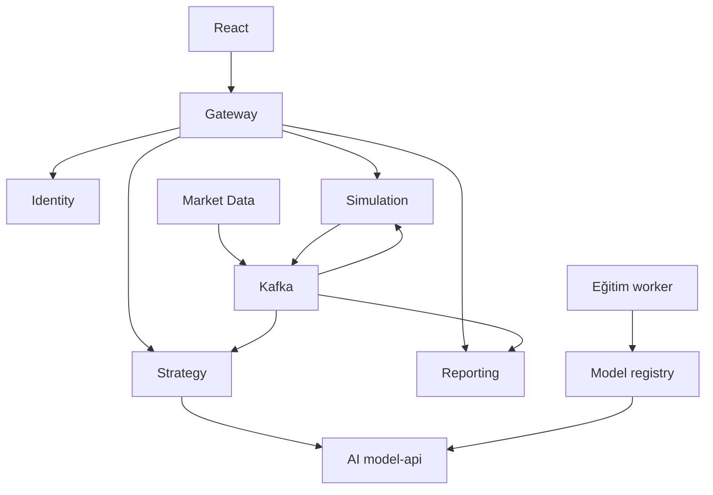

# CryptoLab — Ana proje ve ortak sözleşmeler

Sürüm: 3.0 · Tarih: 12 Ekim 2026 · Durum: kodlamaya esas tasarım; çalışan uygulama veya eğitilmiş model teslimi değildir.

Bu dört belgeli paket, gönderilen `crypto_lab.zip` içindeki ayrıntılı tasarımın yeniden düzenlenmiş sürümüdür. Yeni kapsam yalnızca canlı piyasa verisiyle sanal işlem ve tarihsel araştırma simülasyonudur. Gerçek emir entegrasyonu, gerçek işlem botu, borsa hesabı bağlantısı ve bunlara ilişkin gelecek faz planı kaldırılmıştır. PDF kaynakları yalnızca eğitim hazırlığında kullanılır; çalışan analiz sisteminde PDF okuma, doküman arama veya RAG yoktur.

## 1. Belgeler ve karar otoritesi

| Belge | Sorumluluğu | Kodlamaya başlarken |
|---|---|---|
| [00-ANA-PROJE.md](00-ANA-PROJE.md) | Kapsam, ortak tipler, HTTP/Kafka/AI sözleşmeleri, entegrasyon ve kabul | Her paketle birlikte okunur |
| [01-BACKEND.md](01-BACKEND.md) | Spring Boot mikroservisleri, PostgreSQL, Kafka, Redis, finans motoru, güvenlik | Backend uygulama şartnamesi |
| [02-FRONTEND.md](02-FRONTEND.md) | React ekranları, TypeScript tipleri, akışlar, durum yönetimi ve test | Frontend uygulama şartnamesi |
| [03-AI.md](03-AI.md) | Eğitim PDF’leri, veri seti, sayısal model, açıklama modeli, inference ve değerlendirme | AI uygulama şartnamesi |

Ortak protokolün otoritesi bu dosyadır. Finans matematiğinin otoritesi BACKEND belgesindeki finans bölümüdür. Paketlerden biri farklı DTO/enum üretirse sessiz uyarlama yapılmaz: ortak sözleşme sürümlenir ve tüm tüketiciler birlikte düzeltilir. Eski ZIP’teki dosyalar bu sürüme paralel ikinci gereksinim kaynağı değildir.

Etiketler: **[K]** kullanıcı tarafından kesinleştirilen ürün gereksinimi; **[T]** bu pakette tutarlılık için seçilmiş uygulanacak teknik tasarım; **[A]** ölçüm veya gerçek girdiler gerektiren açık seçim. [T] karar değiştirilmek istenirse önce bu dört belge ve sözleşme testleri güncellenir.

## 2. Ürün ne yapar?

Kullanıcı kayıt olur, giriş yapar ve örneğin 10.000 USDT başlangıç sermayeli bir sanal oturum açar. Kullanıcı herhangi bir uygun varlığı seçebilir veya piyasayı taratabilir. Manuel plan hazırlayabilir ya da AI’dan LONG, SHORT veya WAIT önerisi alabilir. Planın miktarı, teminatı, kaldıraç ve maliyetleri Java finans motoru tarafından hesaplanır. Kullanıcı somut planı onayladığında sanal emir işlenir; pozisyon, stop/hedef, funding, likidasyon ve kapanış izlenir.

Örnek: “1.000 USDT teminat, 10x kaldıraç” yaklaşık 10.000 USDT pozisyon büyüklüğüdür; “1.000 USDT pozisyon” aynı şey değildir. Açılış ücretinin de kullanılabilir bakiyeden karşılanması gerekir. Hesaplama örnekleri BACKEND belgesindedir.

[K] Amaç bitirme projesi olarak Spring Boot tekrarı, mikroservis/Kafka/Redis öğrenimi, React geliştirme ve ölçülebilir AI araştırmasıdır. Modelin bir trader gibi ortak davranışları öğrenmesi araştırma hedefidir; her varlıkta doğru işlem veya kârlılık garantisi değildir.

## 3. Sabit kapsam

- [K] Spring Boot, Kafka, Redis, React korunur. PostgreSQL, JWT, Docker Compose ve Java finans çekirdeği devam eder.
- [K] Kalıcı 5–10 coin listesi yoktur. Entegre sağlayıcılarda keşfedilen varlıklar dinamik katalogdadır. Yeni listeleme, askıya alma ve işlemden kaldırma takip edilir.
- [K] Görüntülenebilir varlık, analiz edilebilir varlık ve sanal vadeli işlem açılabilir kontrat ayrı yeteneklerdir.
- [T] İlk sağlayıcı Binance piyasa verisidir. Kontrat matematiği başlangıçta USDT uzlaşmalı lineer perpetual, isolated margin, one-way konumla sınırlıdır. Bu ürün matematiği sınırıdır; coin sayısı sınırı değildir. Spot verisi katalog/grafik için eklenebilir, bu sürüm spot alım-satım muhasebesi içermez.
- [K] Hedef süreler 60, 900, 3600, 86400, 604800 saniyedir. Mum aralığı, geçmiş pencere ve hedef süre birbirinden ayrıdır.
- [K] Kullanıcı pozisyonunu istediği anda kapatmayı talep edebilir. Veri yoksa gerçekleşme bekler; sahte kapanış üretilmez.
- [T] Etkileşimli simülasyonda tüm yeni girişler kullanıcı onaylıdır. Manuel “Emri gönder” de belirli bir önizlemenin onayıdır. Tarama ve analiz emir yetkisi değildir.
- [K] PDF’ler yalnız eğitim hazırlığı/eğitim sürecinde kullanılır. Normal kullanıcıdan kaynak girişi istenmez. Inference servisinde doküman deposu, OCR veya retrieval bağımlılığı yoktur.
- [K] Tarihsel veriler saklanır, eksikler artımlı tamamlanır. Her analizde yıllarca veri indirilmez ve model yeniden eğitilmez.
- [K] Eksik veri, düşük likidite veya desteklenmeyen model koşullarında işlem önerilmemesi geçerli sonuçtur.

Sistem borsaya emir göndermez. Borsa işlem anahtarı, bağlantılı gerçek cüzdan, para yatırma/çekme ve gerçek emir izleme ekranı bulunmaz. Kademeli tasfiye, ADL, cross margin, hedge mode, opsiyon ve ters kontrat matematiği uygulanmaz. Bunların gelecekte yapılacağını varsayan arayüz, env değişkeni veya servis stub’ı üretilmez.

## 4. Üç paket ve çalıştırılabilir süreçler

Üç kod paketi üç mikroservis anlamına gelmez. Backend kendi içinde bağımsız Spring Boot servislerini içerir. AI paketinde eğitim ile tahmin aynı kod tabanını paylaşsa da ayrı süreçlerde çalışır.

| Paket | Süreç | Görev | Kalıcı veri otoritesi |
|---|---|---|---|
| backend | identity-service | Kimlik, roller, JWT, refresh | identity_db |
| backend | market-data-service | Katalog, fiyat/mum/funding, coverage, veri ihracı | market_db |
| backend | simulation-service | Sanal hesap, emir, risk, ledger, replay | simulation_db |
| backend | strategy-service | Tarama, analiz işleri, AI orkestrasyonu, öneriler | strategy_db |
| backend | reporting-service | Rapor projection, bildirim, CSV | reporting_db |
| backend | api-gateway | Dış route, CORS, limit, SSE proxy | İş verisi yok |
| frontend | web | React kullanıcı arayüzü ve TRAINER çalışma alanı | Finans/model otoritesi yok |
| ai | model-api | Hazır sürümle özellik/tahmin/açıklama | model_db metadata, model artifact |
| ai | training-worker | PDF hazırlama, veri seti, fit/fine-tune, eval | model_db ve training artifact |

[T] AI hesaplama katmanı Python/FastAPI; CPU baseline için scikit-learn. Açıklama modelinin gerçek ince ayarı için açık ağırlıklı model/PEFT adapter’ı. Kesin temel model ve hiperparametreler [A]. Gemini adapter’ı seçilirse yalnız açıklama veya eğitim örneği taslağı üretir; Gemini anahtarı kendi modelini eğitmiş olmak sayılmaz. Ücretli hizmet zorunlu değildir, gizli ücretli fallback bulunmaz.



PDF’ler yalnız eğitim worker’ına girer; inference model artifact’ını yükler. Rapor ekranı gecikmesi hesap bakiyesinin doğruluğunu değiştirmez.

## 5. Kullanım modları

| selectionMode | planMode | Davranış |
|---|---|---|
| USER | MANUAL | Kullanıcı varlık ve işlem parametrelerini belirler |
| USER | AI_PLAN | Kullanıcının seçtiği varlık için AI plan önerir |
| AI_SCAN | MANUAL | Tarama adaylarından kullanıcı seçer ve manuel plan yazar |
| AI_SCAN | AI_PLAN | Tarama adayı için AI plan hazırlar, kullanıcı onaylar |

SessionMode yalnız **LIVE_PAPER** (canlı veri, sanal para) veya **HISTORICAL_REPLAY** (kayıtlı veri, sanal saat) olabilir. “LIVE_PAPER” gerçek para anlamına gelmez. UI Türkçe etiketleri “Canlı veriyle simülasyon” ve “Tarihsel test”tir. Gerçek işlem modu enum’da bulunmaz.

Tarihsel araştırma, seçilmiş dataset ve politika için kapalı run’dır. Her tarihsel satır için kullanıcı onayı gerekmez; run başlatma bu kapsamı yetkilendirir. Replay motoru başka oturuma giriş yetkisi oluşturamaz.

## 6. Ortak temel tipler

| Tip | Normatif tanım |
|---|---|
| Id | UUID string; sembol kimlik değildir |
| Decimal | JSON’da string; `^-?(0|[1-9][0-9]*)(\.[0-9]+)?$`; bilimsel gösterim, NaN/Infinity yok; alan bazında işaret/sınır doğrulanır |
| Instant | UTC ISO-8601, ör. `2026-10-12T15:00:00.000Z` |
| Version | Pozitif JSON integer, iyimser kilit/şema sürümü |
| CursorPage<T> | `{items:T[], nextCursor:string|null, asOf:Instant}`; default 50, max 200 |
| HorizonSeconds | `60 | 900 | 3600 | 86400 | 604800` |
| PositionSide | `LONG | SHORT`; orderSide `BUY | SELL` motor tarafından türetilir |
| OrderType | `MARKET | LIMIT`; attached SL/TP motor içinde stop-market çıkıştır |
| ExpiryPolicy | `REEVALUATE | CLOSE_AT_DEADLINE` |
| DataQuality | `WARMING | FRESH | STALE | GAP | UNAVAILABLE` |
| AnalysisStatus | `QUEUED | WAITING_DATA | RUNNING | SUCCEEDED | FAILED | CANCELLED | EXPIRED` |
| AnalysisAction | `LONG | SHORT | WAIT`; yalnız SUCCEEDED durumunda doludur |
| ExplanationStatus | `PENDING | READY | TEMPLATE | UNAVAILABLE` |
| Role | `USER | TRAINER | ADMIN`; self-register yalnız USER |

UNKNOWN teknik hata ile WAIT ekonomik/kalite sonucu karıştırılmaz. Model servisine erişilemiyorsa analysis FAILED/MODEL_UNAVAILABLE; model değerlendirdi ve giriş uygun bulmadıysa SUCCEEDED/WAIT olur. Her ikisinde proposal bulunmaz.

### 6.1 Instrument

`instrumentId, exchangeId, exchangeSymbol, marketType, baseAsset, quoteAsset, settlementAsset, contractType, settlementModel, status, instrumentVersion, observedAt, capabilities`.

Capabilities: `{dataSupported:boolean, analysisReady:boolean, paperTradable:boolean, reasonCodes:string[]}`. Booleans tek lineer durum değildir. Reason örnekleri: NO_ACTIVE_CONTRACT, UNSUPPORTED_SETTLEMENT_MODEL, INSUFFICIENT_HISTORY, STALE_MARK, MISSING_RULE_PROFILE, LOW_LIQUIDITY, MODEL_OUT_OF_DOMAIN. Model-bazlı analysisReady tahmini bilgidir; her istekte güncel gate uygulanır.

Kimlik uniqueness `(exchangeId, exchangeSymbol, marketType, contractIdentity)`; geçmiş sürümler ayrı tabloda. Sembol yeniden kullanılmışsa eski kontratın history’si sessiz birleştirilmez. Coin enum yazılmaz.

### 6.2 Zaman ve model paketi

`horizonSeconds` hedef; `candleInterval` çözünürlük; `lookbackBars` model gereksinimi; `validUntil` onay son tarihi; `deadlineAt=firstFillAt+horizon` değerlendirme/çıkış anıdır. Haftalık analiz planı da kısa bir onay TTL’sine sahip olabilir.

ActiveModelBundle: `bundleId, numericModelVersion, explanationModelVersion|null, featureVersion, featureSchemaHash, preprocessingHash, policyVersion, supportedHorizons[], artifactHashes, trainingDatasetId, knowledgeTrainingDatasetId|null, releaseStatus`.

`knowledgeTrainingDatasetId` yalnız eğitim köken kaydıdır. Inference bu ID ile PDF aramaz. Model paketi PDF veya vektör indeksi taşımaz. Model değişimi devam eden isteğin sürümünü değiştirmez; istek başında bundle pin edilir.

## 7. HTTP ortak kuralları

Dış prefix `/api/v1`; JSON UTF-8. Kimlik body’deki userId’den değil doğrulanmış JWT’den alınır. Para/miktar string; entity dışarı verilmez. Mutation endpoint’lerinde `Idempotency-Key` zorunlu; hariç auth login/refresh ve salt hesap preview işlemleri için gerekli değildir. Preview için istemci requestId dedupe kullanılabilir.

Idempotency scope `(subject, route, sessionId-or-resourceScope, key)`; normalize request hash saklanır. Aynı key+aynı request aynı sonuç/commandId; farklı request 409 IDEMPOTENCY_CONFLICT. Finans kayıtlarıyla atomik yazılır. Timeout sonrası yeni key üretilmez.

```json
{
  "code": "REVALIDATION_REQUIRED",
  "message": "Fiyat onaylanan aralığın dışına çıktı. Önizlemeyi yenileyin.",
  "traceId": "req-example",
  "retryable": false,
  "details": {"planRevision": 1}
}
```

HTTP: 400 şema, 401 kimlik, 403 yetki, 404 kaynak, 409 sürüm/durum, 422 finans/domain, 429 kota, 503 bağımlılık/veri erişimi. 202 yalnız komut veya job kalıcı kayda girdikten sonra döner. Zaman aşımı işlem gerçekleşmedi kanıtı değildir.

### 7.1 Auth ve piyasa API’leri

| Metot / yol | İstek | Başarılı yanıt |
|---|---|---|
| POST /auth/register | email,password,displayName | 201 UserView |
| POST /auth/login | email,password | 200 accessToken,expiresIn; HttpOnly refresh cookie |
| POST /auth/refresh | cookie + Origin/CSRF | 200 yeni accessToken; dönen refresh cookie |
| POST /auth/logout | cookie + Origin/CSRF | 204 |
| GET /auth/me | Bearer | UserView{id,displayName,roles} |
| GET /market/instruments | cursor,query,capability?,exchangeId? | CursorPage<Instrument> |
| GET /market/instruments/{id} | — | Instrument + coverage |
| GET /market/quotes | instrumentId | MarketSnapshot |
| GET /market/candles | instrumentId,interval,priceKind,from,to,cursor? | CursorPage<Candle> |
| GET /market/funding | instrumentId,from,to | CursorPage<FundingRate> |
| GET /market/rule-profiles/{id} | — | ImmutableRuleProfile |
| GET /market/stream | instrumentId | SSE |

MarketSnapshot: `instrumentId, snapshotId, markPrice, lastPrice|null, bidPrice, askPrice, bidQty, askQty, sourceTime, receivedAt, quality, reasonCodes`. Farklı kaynak zamanları mark/quote alt kayıtlarında korunur; üst sourceTime tek başına her alan taze demek değildir.
Candle: `instrumentId,interval,priceKind,openTime,closeTime,availableAt,open,high,low,close,volume|null,finalized`.

### 7.2 Simülasyon API’leri

Bütün aşağıdaki yollar `/api/v1/sim` altındadır.

| Metot / yol | İstek | Yanıt / kural |
|---|---|---|
| POST /sessions | mode=LIVE_PAPER,initialDeposit,ruleProfileId,riskPolicyId | 201 SessionView |
| GET /sessions; /sessions/{id} | cursor veya id | Sahip olunan session’lar |
| GET /sessions/{id}/wallet | — | WalletView |
| POST /order-previews | ManualPreview veya AiPreview | 201 ExecutionPlan |
| POST /orders | planId,revision,planHash | 202 CommandAccepted; atomik onay+submit |
| GET /commands/{id} | — | CommandView |
| GET /orders; /orders/{id} | sessionId,cursor veya id | OrderView |
| POST /orders/{id}/cancel | expectedVersion | 202 CommandAccepted |
| GET /positions | sessionId,cursor | PositionView listesi |
| POST /positions/{id}/close | expectedVersion,quantity|null | 202 CommandAccepted |
| PUT /positions/{id}/bracket | expectedVersion,stopLoss,takeProfit | 200 PositionView |
| POST /sessions/{id}/halt | reason=MANUAL | 200 SessionView |
| POST /sessions/{id}/resume | expectedVersion | 200; veri/risk gate tekrar |
| POST /sessions/{id}/close-all | expectedVersion | 202; child command IDs sorgulanır |
| GET /sessions/{id}/ledger | cursor | CursorPage<JournalTransaction> |
| GET /sessions/{id}/stream | — | Yetkili session SSE |
| POST /replays | datasetId,profileId,policyArtifactId,seed | 202 ReplayJob |
| GET /replays/{id}; POST /replays/{id}/cancel | id | Durum / 202 |

Tek submit endpoint’i onay ve komut kabulünü atomik yapar. Ayrı `/approvals` endpoint’i yoktur; approval audit satırı sunucuda oluşturulur. Eski paketteki alternatif submit şekilleri uygulanmaz.

ManualPreview: `{source:"MANUAL",sessionId,instrumentId,side,orderType,marginBudget,leverage,limitPrice|null,stopLoss,takeProfit,horizonSeconds,expiryPolicy}`.
AiPreview: `{source:"AI_PROPOSAL",sessionId,proposalId,proposalRevision}`. Kullanıcı AI planını değiştirirse MANUAL preview oluşturulur, köken isteğe bağlı `originProposalId` ile tutulur. Proposal’dan gelen q, fee veya margin otorite değildir.

ExecutionPlan zorunlu alanları: `planId,revision,planHash,sessionId,instrumentId,instrumentVersion,source,proposalId|null,positionGeneration,side,orderType,quantity,referenceEntry,limitPrice|null,marginRequired,openFeeEstimate,notional,leverage,stopLoss,takeProfit,horizonSeconds,expiryPolicy,priceLowerBound,priceUpperBound,maxOpenFee,maxSlippageBps,ruleProfileId,riskPolicyVersion,createdAt,validUntil,estimatedLiquidationPrice|null,warnings[]`. AI planında SL/TP zorunludur. Manuel planda stopLoss/takeProfit null olabilir; risk profilinin requireStopLoss/requireTakeProfit kuralları uygulanır. Verilen değerlerde long için SL<entry<TP, short için TP<entry<SL; tek alan verildiyse ilgili eşitsizlik kontrol edilir. Uygun aralık güncel fill sırasında da doğrulanır.

```json
{
  "planId": "11111111-1111-4111-8111-111111111111",
  "revision": 1,
  "planHash": "sha256:aaaaaaaaaaaaaaaaaaaaaaaaaaaaaaaaaaaaaaaaaaaaaaaaaaaaaaaaaaaaaaaa"
}
```

Bu yalnız POST /sim/orders gövdesidir; fiyat, yön veya miktar tekrar gönderilmez. PlanHash örneği şema bakımından geçerli sentetik değerdir; uygulama gerçek canonical SHA-256 üretir.

CommandAccepted: `{commandId,status:"ACCEPTED",statusUrl,acceptedAt}`. CommandView: `{commandId,status:ACCEPTED|RUNNING|SUCCEEDED|REJECTED,orderId|null,reasonCode|null,updatedAt}`. SUCCEEDED komutun işlendiğini söyler; limit order hâlâ NEW olabilir. Gerçekleşme için OrderView okunur.

OrderStatus: `ACCEPTED | NEW | EXECUTING | EXIT_PENDING_DATA | FILLED | CANCELLED | REJECTED | EXPIRED`. V1 fill full-fill-or-reject’tir; PARTIALLY_FILLED üretilmez. Kullanıcının miktarın bir kısmını kapatması ayrı tam gerçekleşen azaltıcı emirdir. PositionStatus: `OPEN | LIQUIDATING | CLOSED | LIQUIDATED`.
OrderView: `id,sessionId,instrumentId,positionId|null,type,orderSide,quantity,filledQuantity,limitPrice|null,status,reduceOnly,reservedAmount,reasonCode|null,version,createdAt,updatedAt,fills[]`.
PositionView: `id,sessionId,instrumentId,side,quantity,entryPrice,isolatedCash,originalMargin,unrealizedPnl,markPrice,markAsOf,maintenanceMargin,estimatedLiquidationPrice|null,stopLoss,takeProfit,horizonSeconds,deadlineAt,expiryPolicy,status,closeRequested,version,positionGeneration,dataQuality`.
WalletView: `sessionId,availableCash,reservedCash,isolatedCash,unrealizedPnl,equity,asOf,engineSequence,dataQuality`.

### 7.3 Strategy ve rapor API’leri

| Metot / yol | İstek | Yanıt |
|---|---|---|
| POST /strategy/scans | sessionId,horizonSeconds,filters | 202 ScanJob |
| GET /strategy/scans/{id} | — | status,cursor,coverage,candidates |
| POST /strategy/scans/{id}/cancel | — | 202 |
| POST /strategy/analyses | sessionId,instrumentId,horizonSeconds | 202 AnalysisJob |
| GET /strategy/analyses/{id} | — | AnalysisView |
| GET /strategy/proposals/{id} | — | ProposalView |
| GET /reports/sessions/{id}/summary | — | SummaryView |
| GET /reports/sessions/{id}/equity | interval | Samples + projectionAsOf |
| GET /reports/sessions/{id}/trades | cursor | CursorPage<TradeSummary> |
| GET /reports/notifications | cursor | CursorPage<Notification> |
| POST /reports/notifications/{id}/read | — | 204 |
| POST /reports/exports | sessionId,format=CSV | 202 ExportJob |
| GET /reports/exports/{id} | — | status,authorizedDownloadPath|null |

AnalysisView: `id,sessionId,instrumentId,horizonSeconds,status,action|null,reasonCodes[],modelBundleId|null,featureSnapshotId|null,marketAsOf|null,proposalId|null,explanationStatus,explanation|null,createdAt,updatedAt`.
ProposalView: `id,revision,sessionId,instrumentId,positionGeneration,action:LONG|SHORT,orderType,limitPrice|null,suggestedLeverage,stopLoss,takeProfit,horizonSeconds,expiryPolicy,modelBundleId,featureSnapshotId,policyVersion,createdAt,validUntil,reasonCodes[]`. Margin/quantity kullanıcı risk politikası ile Simulation tarafından belirlenir. WAIT proposal üretmez. Açıklama boş olabilir; sayısal/risk değerlendirmesi gerekçeleri reasonCodes ile görünür.

### 7.4 Eğitim yönetimi dış API’si

Yalnız TRAINER/ADMIN; `/api/v1/strategy/training` altında Strategy facade ile AI’ye gider. USER erişimi 403. Dosya limitleri ayrı route konfigürasyonudur.

| Metot / son ek | İstek | Sonuç |
|---|---|---|
| POST /sources | multipart PDF + title,author?,rightsDeclaration | 202 SourceJob |
| POST /source-imports | url,title,rightsDeclaration | 202 SourceJob |
| GET /sources; /sources/{id} | cursor/id | Metadata, training-only durum |
| GET /sources/{id}/pages/{page} | yetki | Güvenli sayfa önizlemesi |
| DELETE /sources/{id} | expectedVersion | 202 silme işi/lineage işareti |
| POST /example-jobs | sourceVersionIds,taskTypes | 202 Job |
| GET /examples | datasetId,cursor | Eğitim örnekleri |
| PATCH /examples/{id} | expectedVersion,reviewStatus,correctedTarget? | 200 Example |
| POST /datasets | numeric/export veya reviewed-example manifest | 201 Dataset |
| POST /runs | task,datasetId,baseModelRevision?,config,seed | 202 TrainingRun |
| GET /runs/{id}; POST /runs/{id}/cancel | — | Durum / 202 |
| GET /models; /models/{id} | — | ModelCard |
| POST /models/{id}/promote | expectedAliasVersion,evaluationId | 200 Release |
| POST /models/{id}/rollback | expectedAliasVersion,reason | 200 Release |

TRAINER veri/eğitim yönetebilir; promotion ve rollback için ek `MODEL_PUBLISH` authority gerekir, ADMIN kontrollü verir. Kullanıcı kendi rolünü değiştiremez.

## 8. Backend ↔ AI iç sözleşmesi

Frontend AI servisine doğrudan ulaşmaz. İç çağrılar servis kimliği, requestId, actor scope ve deadline taşır; dış istemcinin bu header’ları gateway tarafından temizlenir. `/internal/**` dış route değildir.

### 8.1 Market veri manifesti

AI, Market export API’siyle immutable artifact alır: `POST /internal/market/dataset-exports {instrumentIds,from,to,intervals,priceKinds,asOfCutoff}` → 202 jobId; `GET .../{id}` → READY olduğunda `{datasetId,artifactId,sha256,coverage,missingRanges,availableAtPolicy}`. Artifact indirmesi yetkili internal endpoint ile; dışarıdan gelen rastgele URL çalıştırılmaz.

### 8.2 Tahmin isteği

`POST /internal/model/predictions`:

```json
{
  "requestId": "22222222-2222-4222-8222-222222222222",
  "instrumentId": "33333333-3333-4333-8333-333333333333",
  "horizonSeconds": 3600,
  "asOf": "2026-10-12T15:00:00.000Z",
  "modelBundleId": "44444444-4444-4444-8444-444444444444",
  "marketDatasetId": "55555555-5555-4555-8555-555555555555",
  "marketSnapshotId": "66666666-6666-4666-8666-666666666666",
  "featureVersion": "features-v1"
}
```

İç model request’i session bakiyesi, borsa anahtarı, PDF, collection, corpus veya retrieval query içermez. Model finans hesabı sahibi değildir. marketDatasetId kısa pencerenin immutable manifesti de olabilir; her request tam tarih indirimi yapmaz.

Başarılı PredictionResult: `requestId,quality:READY|INSUFFICIENT_DATA|OUT_OF_DOMAIN|STALE_DATA,reasonCodes[],modelBundleId,featureVersion,featureSchemaHash,featureSnapshotId,asOf,horizonSeconds,predictedLogReturn|null,volatilityEstimate|null,calibrationVersion|null,observedFeatureSummary,latencyMs`.
Skorlar finite JSON number olabilir; finans fiyatı/quantity olarak doğrudan kullanılmaz. QUALITY!=READY olduğunda sayısal output’lar null; Strategy WAIT döndürür. API/artefact hatasında 5xx/4xx; başarı gibi quality uydurulmaz. Para hesaplarına giren özellikler (ATR fiyatı gibi) ayrıca Decimal string olarak, sürümlü dönüşümle aktarılır.

`POST /internal/model/explanations {requestId,modelBundleId,predictionResult,validatedPolicyOutcome,verifiedFeatureSummary,language:"tr"}` → `{status:READY|TEMPLATE|UNAVAILABLE,explanationModelVersion|null,text,reasonCodes,latencyMs}`. PDF/retrieval alanı yoktur. Açıklama sayısal sonucu veya miktarı değiştiremez; uydurma kitap/sayfa referansı gösterilmez.

`GET /internal/model/active-bundle?horizonSeconds=...` sürümü çözer. Eğitim uç noktaları `/internal/training/**`; dış training facade ile aynı DTO anlamını taşır. İç `POST /internal/sim/replay-evaluations` datasetId, policyArtifactId, ruleProfileId, seed alır; AI’ye finans motorunun maliyetli sonuç artifact’ını döndürür.

## 9. Kafka sözleşmeleri

| Topic | Key | Üreten → tüketen |
|---|---|---|
| market.mark.v2 | instrumentId | Market → Simulation, Strategy |
| market.quote.v2 | instrumentId | Market → Simulation |
| market.candle.closed.v2 | instrumentId:interval | Market → Strategy, AI feature consumer |
| market.funding.settled.v2 | instrumentId | Market → Simulation |
| market.instrument.v2 | instrumentId | Market → Simulation, Strategy |
| system.data-quality.v2 | source:instrumentId | Market → Simulation, Strategy, Reporting |
| simulation.events.v2 | sessionId | Simulation → Reporting, Strategy |
| strategy.proposals.v1 | sessionId | Strategy → Reporting |
| model.lifecycle.v1 | modelVersionId | AI → Strategy, Reporting |
| training.jobs.v1 | jobId | AI → Strategy training projection |

Temel zarf: `eventId,eventType,schemaVersion,occurredAt,recordedAt,producer,aggregateId,aggregateVersion,correlationId,causationId|null,payload`. Simulation olayları ayrıca `sessionId,engineSequence,transactionId,transactionOrdinal` taşır. Session engineSequence olay başına monoton artar; aynı transaction içindeki olaylar farklı sıra alır. UUID eventId tekrar teslimde değişmez. Finans/numeric market alanları Decimal string’dir.

Payload zorunluları:
- MarkUpdated: instrumentId,markPrice,sourceTime,receivedAt,connectionEpoch,sourceSequence|null.
- QuoteUpdated: instrumentId,bidPrice,bidQty,askPrice,askQty,sourceTime,receivedAt,connectionEpoch,updateId.
- CandleClosed: instrumentId,interval,priceKind,openTime,closeTime,availableAt,open,high,low,close,volume|null,finalized=true.
- FundingRateSettled: instrumentId,settlementTime,rate,settlementMark,sourceRecordId.
- InstrumentChanged: instrumentId,instrumentVersion,status,capabilities,observedAt.
- LedgerTransactionPosted: journalTransactionId,sessionId,postings[{accountId,amount,currency}],reason,effectiveAt,positionId|null,orderId|null.
- PositionOpened/Reduced/Closed/Liquidated: positionId,instrumentId,positionVersion,remainingQuantity,exitReason|null; para toplamlarının otoritesi değildir.
- SessionValuationUpdated: sessionId,engineSequence,asOf,equity,unrealizedPnl,dataQuality; rapor equity örneklemesi için.
- ProposalCreated: proposalId,revision,sessionId,instrumentId,validUntil,modelBundleId.
- ModelPromoted: modelVersionId,bundleId,aliasVersion,featureVersion,artifactHash.
- TrainingJobChanged: jobId,task,status,stage,progress|null,updatedAt; PDF metni/model binary yok.

At-least-once teslim varsayılır. DB business update + inbox + outbox aynı transaction; offset commit sonrasında. Outbox publisher başarısızlığında tekrar gönderim normaldir. Kafka producer idempotence tek başına parasal DB idempotency sağlamaz. Market topic’leri arası toplam sıra yoktur; Simulation kendi accepted-input journal’ına engine sırası verir. Parasal olayda bozuk mesaj atlanıp sonraki kayıtlar körlemesine işlenmez: partition pause, karantina, alarm, kontrollü devam.

## 10. SSE sözleşmesi

Market stream: `event: market.snapshot`, `id: streamEpoch:sequence`, `data: MarketSnapshot`.
Session stream: `event: session.changed`, data `{sessionId,engineSequence,changedResources:["wallet","orders","positions"],asOf}`; frontend ilgili authoritative snapshot’ı tazeler. Bütün hesap state’ini kısmi patch ile birleştirmek zorunlu değildir.
Job progress başlangıçta GET polling ile alınır; Kafka doğrudan tarayıcıya açılmaz. Stream boşluğu varsa REST resync; ring buffer’da Last-Event-ID bulunamıyorsa `event: resync.required`. Son sıra küçükse eski event uygulanmaz. SSE auth Bearer destekli fetch parser ile; URL’de token yok.

## 11. Onay ve pozisyon yaşam döngüsü

Preview sunucu snapshot’ıyla quantity ve maliyetleri sabitler. Submit JWT sahibi + planId/revision/hash + session + positionGeneration + expiry + güncel data/risk kontrolünden geçer. Approval kaydı ve command atomik yaratılır/consume edilir. Aynı plan iki emir yaratamaz; `(planId,revision)` unique execution bağı vardır. İşçi son fill öncesi fiyat/maliyet gate’i yeniden uygular. Quantity değiştirilerek eski onay kullanılamaz.

Plan canonicalization: şema alan sırası sabit DTO; Decimal trailing zero normalize; UTC milisaniye; null alanlar dahil; UTF-8; SHA-256. Hash alanı ve UI warnings hash girdisinden çıkarılır, yürütülebilir bütün alanlar dahildir. Backend’de golden canonical byte fixture tutulur.

Kullanıcı close: kalıcı closeRequested ve positionGeneration artışı aynı kilitte; eski proposal/preview geçersiz; bekleyen bağlı entry iptal. Strategy iptal olayını henüz almamış olsa da Simulation generation kontrolüyle eski planı reddeder. Kısmi kapanış yalnız kalan miktar kadar; SL/TP kalan miktara iner. Tek session kilidi manual close/stop/liquidation yarışını çözer.

REEVALUATE deadline’da bildirim ve analiz oluşturur; mevcut pozisyonu genişletmez. CLOSE_AT_DEADLINE onaylı azaltıcı çıkıştır. DB due queue `(positionId,generation,deadlineAt)` unique; restart veya çift timer tek etki. Horizon pozisyonu kilitlemez.

## 12. Veri doğruluğu, risk ve kaynak bütçesi

Mark değerleme/likidasyon; bid/ask fill; trade last/mum strateji/grafik içindir. Source/received zamanları saklanır. Varsayılan maxAge örnekleri mark 5 sn, quote 2 sn; proje config’idir, borsa garantisi değildir. Stale durumda yeni giriş yok; çıkış isteği kaydedilir, taze quote beklenir. Fiyat boşluğu fidelity=DEGRADED yapar; son snapshot geçmişte likidasyon olmadığını kanıtlamaz.

Katalog sınırsız liste iddiasıyla bütün order book’ları sonsuza kadar açmaz. Hot: açık pozisyon ve bekleyen çıkış; warm: analiz/tarama; cold: metadata ve ihtiyaç bazlı history. Stream bütçesi kaynak kontrolüdür; kalıcı coin kısıtı değildir. Tarama cursor/coverage raporlar, her tur ilk birkaç varlıkta takılmaz.

Simulation finans kaynağı PostgreSQL ledger’dir. Redis cache/kota; Kafka dağıtım; Reporting eventual projection’dır. AI veya rapor kesintisi açık pozisyonların risk kontrolünü durdurmaz. Market kesintisi veri eksikliği olarak açık gösterilir.

## 13. Aşamalı geliştirme — tek ürün kapsamı

1. Saf Java finans çekirdeği, sayısal fixture’lar ve ledger invariant’ları.
2. Simulation REST + PostgreSQL + manuel fixture akışı.
3. Identity, JWT ve React kayıt/giriş/manuel işlem.
4. Kafka Market→Simulation→Reporting; sonra Redis cache.
5. Dinamik katalog, gerçek public veri, reconnect/gap ve data gate.
6. AI fake adapter (etiketli), immutable data export, CPU sayısal eğitim ve hazır model inference.
7. Strategy tarama/plan/onay; React AI ekranları.
8. TRAINER PDF hazırlama, reviewed dataset, açık model fine-tuning, karşılaştırma ve versioned promotion.
9. Replay/evaluation, dayanıklılık, compose demo ve tez raporu.

Bunlar geliştirme sırasıdır; gerçek bot fazı yoktur. Ara teslimde yalnız sayısal model varsa “PDF ile eğitilmiş trader tamamlandı” denmez. PDF fine-tuning hedefi için gerçekten eğitilmiş artifact ve önce/sonra değerlendirmesi gerekir.

## 14. Teslim ve kabul

| ID | Senaryo | Beklenen kanıt |
|---|---|---|
| A01 | Hiç PDF eklememiş USER analiz/işlem yapar | E2E kayıt→analiz→onay→fill→close |
| A02 | Eğitim deposu/worker kapalı | Hazır model inference ve manuel işlem sürer |
| A03 | Inference container | PDF/OCR/retrieval paketi/volume zorunluluğu yok |
| A04 | Yeni eligible varlık | Kodda coin enum değişmeden katalog ve analiz |
| A05 | Scan veya training başlatılır | Yeni order oluşmaz |
| A06 | Duplicate submit / Kafka / funding | Tek finans etkisi |
| A07 | Mark ve last farklı | Likidasyon mark’tan |
| A08 | Eski plan / fiyat sınırı / close generation | Emir yok, doğru reason |
| A09 | Model eğitimde görmediği varlık ve gelecek dönem | Ayrı cohort maliyetli rapor |
| A10 | Train/test sızıntısı | Eğitim gate fail |
| A11 | PDF yalnız eklendi | Model sürümü değişmez |
| A12 | Fine-tuning tamamlandı | Hash’li yeni ağırlık/adapter, ayrı eval |
| A13 | Rapor yeniden oluşturulur | Ledger toplamlarıyla mutabakat |
| A14 | Kaynak/servis hatası | Başarılı analiz veya fill uydurulmaz |
| A15 | Ağ yüzeyi ve config | Yalnız veri sağlayıcı entegrasyonu; gerçek emir adapter’ı yok |

Uygulama kabul kapıları: sıfır ledger imbalance; para etkisinin tekrarlanmaması; kullanıcılar arası yetki testi; active modelin hata durumunda korunması; JSON/OpenAPI/event schema contract testleri; seed ve fixture ile yeniden üretilebilen demo. Kâr pozitifliği bilimsel sonuçtur, doğruluk testinin yerine geçmez.

## 15. Açık bilgiler ve sürüm kilidi

[A] Tam Java/Spring BOM uyumu, React/Node/Python/ML sürümleri implementation başlangıcında mevcut toolchain’e göre lock edilir. Ana teknoloji seçimi değişmez. Eski belgelerdeki örnek port/sürüm güncel destek garantisi sayılmaz.
[A] Açık açıklama modelinin adı, lisansı, VRAM/RAM gereksinimi, eğitim süresi, gerçek PDF seti, örnek sayısı, veri erişimi ve performans eşikleri ölçümle seçilecektir. Kod bunları config/manifest alanı olarak taşır; bilinmeyen donanımı varsaymaz.
[A] Tam dönemler ve validation kabul eşikleri test sonucu görülmeden dondurulur. Test setini optimize etmek için yeniden tekrar seçme yoktur.

Tasarım kaynağı: yüklenen `crypto_lab.zip`. Bu sürümde dokümanlar yeniden yazılmış, finans muhasebesi korunmuş, çelişen onay alternatifleri tek endpoint altında birleştirilmiş ve eğitim/çalışma zamanı ayrımı kesinleştirilmiştir. Doküman kontrolü uygulama testlerinin çalıştırıldığı anlamına gelmez.

## 16. Uygulanabilir sözleşme eki

### 16.1 RiskPolicy ve oturum kısıtları

RiskPolicy zorunlu alanları: `id,version,maxLeverage,maxConcurrentPositions,maxPositionNotional,maxTotalNotional,maxMarginPerTrade,riskFraction,maxDailyLossFraction,requireStopLoss,requireTakeProfit,minLiquidityParticipation,markMaxAgeMs,quoteMaxAgeMs,maxClockSkewMs,previewTtlSeconds,maxSlippageBps,maxOpenFeeRate`.

Oranlar Decimal, yaş/TTL pozitif integer; maxSlippageBps ve leverage sınırları şemada. RiskFraction ∈ (0,1], dailyLossFraction ∈ (0,1]; eğitim default örneği riskFraction=0.01, günlük=0.05, maxLeverage=10, maxConcurrentPositions=2. Bunlar karşılaştırılacak konfigürasyon örnekleridir; güvenli kazanç taahhüdü değildir. MaxNotional/margin limitleri profile creation’da girilir, gizli sınırsız default yoktur.

AI sizing: `riskBudget=max(0,equity)*riskFraction`; qRisk stop mesafesi+maliyet tamponuyla; qMargin available ve maxMarginPerTrade ile; qNotional sözleşme ve hesap tavanlarıyla. Sonuç min değerinin step floor’u. Minimum lotu karşılamıyorsa plan yok. Manual marginBudget qMargin sınırına tabidir; stop varsa aynı risk limiti de uygulanır. Profil stop zorunlu kılıyorsa null manuel istek reddedilir. Risk policy değişimi yeni plan gerektirir; session rule profile sabittir.

SessionView: `id,ownerId,mode,status,initialDeposit,ruleProfileId,riskPolicyId,riskPolicyVersion,createdAt,version,tradingEnabled,haltReasons[],engineSequence`. Order mutation state=RUNNING ve gates FRESH ister; close/halt istisnaları backend’de açıkça doğrulanır.

PlanState: `PREVIEWED | CONSUMED | EXPIRED | REVOKED | SUPERSEDED`. ProposalState: `READY | EXPIRED | REVOKED`. Plan TTL server’dan gelir. Expired veya consumed planı yeniden PREVIEWED yapma; yeni revision/hash üret.

### 16.2 Job sonuç tipleri

ScanJob: `id,sessionId,horizonSeconds,status:QUEUED|RUNNING|PARTIAL|SUCCEEDED|FAILED|CANCELLED,universeSnapshotId,cursor|null,totalKnown,evaluatedCount,skippedCount,reasonCounts,candidates[],createdAt,updatedAt`. PARTIAL iş tamamlanmış fakat kapsam tamamlanamamıştır; tekrar devam istenirse yeni job önceki cursor’u referans alabilir. RUNNING progress’te kapsam henüz tam değildir.

ReplayJob: `id,status:QUEUED|RUNNING|SUCCEEDED|INDETERMINATE|FAILED|CANCELLED,datasetId,ruleProfileId,policyArtifactId,seed,resultArtifactId|null,fidelity,dataLayer,ambiguousBarCount,createdAt,updatedAt`.
DataLayer `RECORDED_TICKS | PAIRED_OHLC | TRADE_ONLY`; Fidelity `EXACT_WITHIN_MODEL | APPROXIMATE | DEGRADED | INDETERMINATE`. EXACT_WITHIN_MODEL yalnız eksiksiz gözlenen tick/journal ve tanımlı model için; borsayla birebir eşitlik anlamına gelmez. TRADE_ONLY tasfiye doğruluğu için INDETERMINATE; strateji deneyi APPROXIMATE raporlanabilir.

SourceJob: `jobId,sourceId,sourceVersionId|null,status,stage,qualityIssues[],createdAt,updatedAt`. Status `QUEUED | RUNNING | SUCCEEDED | FAILED | CANCELLED`; stage PDF sürecindeki `FETCHING | VALIDATING | EXTRACTING | REVIEW_REQUIRED | READY_FOR_EXAMPLES`. Kaynak state’i ile job status’u iki ayrı alandır.
TrainingRun: `id,task,status,stage,datasetId,modelVersionId|null,progress|null,errorCode|null,metricsReportId|null,createdAt,updatedAt`. Task NUMERIC/EXPLANATION_SFT. Progress mevcutsa `{completedUnits,totalUnits,unit}`; sahte epoch/yüzde yok.
ModelCard: `modelVersionId,task,status,baseRevision|null,artifactHash,featureVersion|null,trainingDatasetId,splitManifestId,metricsReportId,limitations[],createdAt`.

SummaryView: `sessionId,initialEquity,currentEquity,realizedPnl,unrealizedPnl,totalFees,signedFunding,liquidationFees,insuranceAdjustment,closedTradeCount,winRate|null,profitFactor|null,maxDrawdown|null,projectionAsOf,lastEngineSequence,lagMs,fidelity`. Oranların kesir olduğu field açıklamasında belirtilir; yüzdeye çevirmek UI gösterimidir.

### 16.3 Strict submit JSON Schema örneği

Kodlamada aşağıdaki schema `contracts/http/submit-order.schema.json` olarak oluşturulur. Ortak protokol değişmeden elle yazılmış ikinci submit DTO kabul edilmez.

```json
{
  "$schema": "https://json-schema.org/draft/2020-12/schema",
  "title": "SubmitOrderRequest",
  "type": "object",
  "additionalProperties": false,
  "required": ["planId", "revision", "planHash"],
  "properties": {
    "planId": {"type": "string", "format": "uuid"},
    "revision": {"type": "integer", "minimum": 1},
    "planHash": {"type": "string", "pattern": "^sha256:[0-9a-f]{64}$"}
  }
}
```

Diğer command request’leri de strict additionalProperties=false ile. Event consumer additive extra alanlara tolerant, required eksikliği ve type hatasına intolerant. UUID/Instant format validator gerçekten etkinleştirilir; yalnız schema’da yazmak her kütüphanede format kontrolü sağlamaz.

### 16.4 Kafka örnek olayı

```json
{
  "eventId": "aaaaaaaa-aaaa-4aaa-8aaa-aaaaaaaaaaaa",
  "eventType": "LedgerTransactionPosted",
  "schemaVersion": 2,
  "occurredAt": "2026-10-12T15:00:00.000Z",
  "recordedAt": "2026-10-12T15:00:00.020Z",
  "producer": "simulation-service",
  "aggregateId": "bbbbbbbb-bbbb-4bbb-8bbb-bbbbbbbbbbbb",
  "aggregateVersion": 1,
  "correlationId": "cccccccc-cccc-4ccc-8ccc-cccccccccccc",
  "causationId": "dddddddd-dddd-4ddd-8ddd-dddddddddddd",
  "sessionId": "eeeeeeee-eeee-4eee-8eee-eeeeeeeeeeee",
  "engineSequence": 3,
  "transactionId": "bbbbbbbb-bbbb-4bbb-8bbb-bbbbbbbbbbbb",
  "transactionOrdinal": 1,
  "payload": {
    "journalTransactionId": "bbbbbbbb-bbbb-4bbb-8bbb-bbbbbbbbbbbb",
    "sessionId": "eeeeeeee-eeee-4eee-8eee-eeeeeeeeeeee",
    "reason": "INITIAL_CAPITAL",
    "effectiveAt": "2026-10-12T15:00:00.000Z",
    "positionId": null,
    "orderId": null,
    "postings": [
      {"accountId": "11111111-1111-4111-8111-111111111112", "amount": "10000", "currency": "USDT"},
      {"accountId": "11111111-1111-4111-8111-111111111113", "amount": "-10000", "currency": "USDT"}
    ]
  }
}
```

Posting toplamı sıfırdır. eventId tekrar teslimde aynıdır; transactionOrdinal business transaction içi sıradır. Kafka metadata offset’i business event kimliği değildir.

### 16.5 Kritik hata kodları ve istemci davranışı

| Kod | HTTP/job | Davranış |
|---|---|---|
| IDEMPOTENCY_CONFLICT | 409 | Aynı key farklı body; kullanıcı eylemini incele, kör tekrar yok |
| VERSION_CONFLICT | 409 | Kaynağı tazele, değişikliği kullanıcı yeniden değerlendirir |
| REVALIDATION_REQUIRED | 409/command REJECTED | Yeni preview ve onay |
| PLAN_EXPIRED / PLAN_REVOKED | 409 | Eski planla submit yok |
| INSUFFICIENT_AVAILABLE_BALANCE | 422 | Budget değiştir; ücret dahil açıklama |
| INSTRUMENT_NOT_TRADABLE | 422 | Capability reason göster |
| STALE_MARK / STALE_QUOTE | 503 | Giriş durur; veri tazelenmesini bekle |
| LIQUIDITY_LIMIT | 422/order reason | Modelin miktar sınırı; kapanış state’i ayrı takip |
| MODEL_NOT_READY / MODEL_UNAVAILABLE | 503/job FAILED | Eğitilmiş tahmin uydurma |
| INSUFFICIENT_HISTORY | Analysis SUCCEEDED/WAIT | Veri hazırlanabilir, emir yok |
| OUT_OF_DOMAIN | Analysis SUCCEEDED/WAIT | Model uygun değerlendiremiyor |
| FEATURE_SCHEMA_MISMATCH | internal 422/job FAILED | Kod/model uyumunu düzelt |
| TRAINING_SOURCE_INVALID | job FAILED | Eğitmen kaynak kontrolü |
| PUBLISH_GATE_FAILED | 422 | Aday active olmaz |

### 16.6 Sözleşme geliştirme kapısı

Kodlamanın ilk ortak işi `contracts/http`, `contracts/events`, `contracts/internal-ai`, `contracts/fixtures` yapısını oluşturmak. Bu MD’nin alanları OpenAPI/JSON Schema’ya çevrilir. Java DTO, TypeScript client ve Pydantic modeller aynı fixture’larla doğrulanır. Contracts semver ilk uygulamada 1.0.0; belge sürümü 3.0 farklı kavramdır. CI backward compatibility/additive event alan testleri ve strict command testlerini çalıştırır. Async event testleri payload kadar key ve dedupe kimliğini de doğrular.

Örnek entegrasyon fixture’ı: E=50000,q=0.2,L=10,initial cash=10000,taker=.0005; backend preview/open sonucu A=8995,B=1000. UI aynı string değerleri gösterir. AI bu sayıları yeniden hesaplamaz; test sadece tavsiye/feature sözleşmesini doğrular. Böylece paketler ayrı kodlanırken tek finans gerçeği korunur.

## 17. Bu doküman paketinin kontrol kaydı

12 Ekim 2026: dört Markdown dosyasında 13 yerel bağlantı ve 6 JSON örneği kontrol edildi; kod blokları dengeli. Python Decimal ile 22 finans fixture/eşik kontrolü yeniden çalıştırıldı. Strict submit schema’sında geçerli örnek ve üç geçersiz istek kontrol edildi. Bu kontroller belge örneklerine aittir. Java/React/AI uygulaması geliştirilmedi, gerçek piyasa bağlantısı veya model eğitimi yapılmadı; uygulama kabul testleri kodlama aşamasında çalıştırılacaktır.
