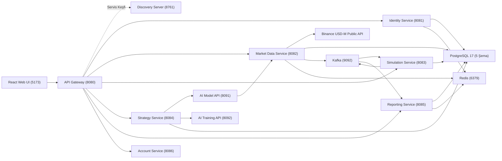

# CryptoLab

Canlı kripto türev piyasa verileri üzerinde izole marjinli sanal vadeli işlem simülasyonu, kantitatif AI sinyal/tarama motoru ve deterministik tarihsel backtest (replay) sunan çok servisli finansal araştırma platformu.


> **Simülasyon Kapsamı:** CryptoLab yalnızca sanal USDT bakiyeleri ve eğitim/araştırma amaçlı işlem simülasyonu çalıştırır. Gerçek borsalara emir gönderilmez; borsa işlem anahtarı, gerçek cüzdan bağlantısı veya para yatırma/çekme işlevi bulunmaz. Kontrat matematiği USDT uzlaşmalı lineer perpetual, izole marjin (`isolated margin`) ve tek yönlü (`one-way`) pozisyonlarla sınırlıdır.

---

## İçindekiler

1. [Ürün Ne Sunar?](#ürün-ne-sunar)
2. [Öne Çıkan Özellikler](#öne-çıkan-özellikler)
3. [Mimari ve Veri Akışı](#mimari-ve-veri-akışı)
4. [Teknoloji Yığını ve Temel Tasarım Tercihleri](#teknoloji-yığını-ve-temel-tasarım-tercihleri)
5. [Kurulum ve Yerel Çalıştırma Kılavuzu (IntelliJ IDEA + VS Code)](#kurulum-ve-yerel-çalıştırma-kılavuzu-intellij-idea--vs-code)
6. [Test, Derleme ve Doğrulama Komutları](#test-derleme-ve-doğrulama-komutları)
7. [Bulut Dağıtım Şablonları ve İlgili Dokümanlar](#bulut-dağıtım-şablonları-ve-ilgili-dokümanlar)
8. [Bilinen Sınırlamalar ve Mevcut Kapsam](#bilinen-sınırlamalar-ve-mevcut-kapsam)
9. [Lisans](#lisans)

---

## Ürün Ne Sunar?

CryptoLab; bir yatırımcının veya araştırmacının canlı kripto türev fiyatlarını izleyip sanal USDT cüzdanları açabilmesini, manuel ya da AI destekli pozisyon planları oluşturup risk limitleri içinde test edebilmesini, hesap defteri üzerinden K&Z (PnL) mutabakatını takip etmesini ve tarihsel piyasa verileri üzerinde tekrarlanabilir replay deneyleri yürütmesini sağlar.

### Temel Kullanım Senaryoları

* **Canlı Piyasa ve Sanal İşlem Oturumları:** Kullanıcı kayıt olup bağımsız sanal USDT cüzdanları oluşturur; komisyon kademesi ile kaldıraç/günlük kayıp freni politikasını seçerek gerçek piyasa kotasyonları üzerinde kaldıraçlı `MARKET` / `LIMIT` emirleri ve Stop-Loss / Take-Profit seviyeleri test eder.
* **Kantitatif AI Analiz ve Piyasa Taraması:** Seçili bir parite veya tüm uygun piyasa için 1 dakika ile 1 hafta arasındaki 5 ufukta `LONG`, `SHORT` ya da maliyet/belirsizlik temelli `WAIT` kararı üretir; önerilen plan tek tıkla emir terminaline aktarılıp sunucu onayından sonra işleme alınır.
* **Tarihsel Araştırma ve Eğitmen (`TRAINER`) Yaşam Döngüsü:** Geçmiş veriler üzerinde sanal saatli deterministik replay çalıştırılır; `TRAINER` ve `ADMIN` rolleri için ayrılmış alanda PDF kaynakları, SFT örnek incelemesi, veri seti dondurma ve versiyonlu model yayına alma/geri alma (`promote`/`rollback`) süreçleri yönetilir.

---

## Öne Çıkan Özellikler

* **Canlı Piyasa Terminali (`/market`):** `market-data-service` üzerinden Binance USD-M Futures halka açık API (`fapi.binance.com` ve kısıtlı bölgeler için `data-api.binance.vision` yedeği) kullanılarak dinamik enstrüman kataloğu, 24 saatlik ticker tablosu, `markPrice` / `lastPrice` / `bid` / `ask` / funding oranı kotasyonları, çok zaman dilimli mum verisi (`1m`, `5m`, `15m`, `1h`, `4h`, `1d`) ve SSE canlı fiyat akışı (`lightweight-charts` arayüzüyle) sunulur.
* **Sanal Cüzdanlar ve Emir Motoru (`/sessions`, `/trade/:sessionId`):**
  * Üç komisyon kademesi (*Standart USD-M*, *VIP Kurumsal*, *Scalping & Algo*) ve üç risk politikası (*Muhafazakâr 5x / %2 Fren*, *Dengeli İzole 20x / %5 Fren*, *İleri Seviye 50x / %10 Fren*).
  * Sunucu tarafında hesaplanan marjin, komisyon ve tahmini likidasyon fiyatını sabitleyen canonical SHA-256 imzalı `ExecutionPlan` önizlemesi (`/order-previews`) ve `Idempotency-Key` korumalı atomik emir gönderimi (`/orders`).
  * Arka planda otomatik Stop-Loss, Take-Profit ve likidasyon izleme; kısmi veya tam pozisyon kapatma, bracket güncelleme, açık emir iptali, oturum durdurma/devam ettirme (`halt`/`resume`/`close-all`), cüzdan K&Z özeti ve cüzdan silme.
* **Kantitatif AI Analiz ve Piyasa Taraması (`/analysis/:sessionId`, `/scan/:sessionId`):**
  * 20 nedensel özellikli (`features-quant-v4`) çok zaman dilimli (`60`, `900`, `3600`, `86400`, `604800` sn) ve üç risk seviyeli (`LOW`, `MEDIUM`, `HIGH`) `quant-horizon-v4` model paketi.
  * Maliyeti kurtarmayan net getiri veya yetersiz/bayat veri koşullarında sahte yön üretmeden `WAIT` kararı döndürme.
  * Üretilen sinyali zarar-durdur / kâr-al değerleriyle doğrudan Emir Terminali'ne aktarma.
* **Muhasebe Defteri, Raporlar ve Replay (`/reports/:sessionId`, `/history/:sessionId`, `/replay`):**
  * Çift taraflı muhasebe defteri (`ledger`) üzerinden kullanılabilir bakiye, izole marjin, toplam komisyon ve realize/realize edilmemiş K&Z raporlaması.
  * HMAC imzalı imleçle sayfalanan işlem geçmişi (`account-service` & `reporting-service`).
  * `ReplayPage` üzerinden veri katmanı (`RECORDED_TICKS`, `PAIRED_OHLC`, `TRADE_ONLY`) ve doğruluk düzeyi (`fidelity`) bilgisini koruyan deterministik tarihsel simülasyon ve CSV indirme.
* **Kimlik, Güvenlik ve İzole Yönetim/Eğitim Alanları (`/login`, `/register`, `/training/*`, `/admin`):**
  * `identity-service` içinde RSA-2048 imzalı kısa ömürlü JWT, diğer tüm servislerde JWKS üzerinden imza doğrulama; frontend'de access token yalnız JS modül belleğinde tutulur (`localStorage`'a yazılmaz), `HttpOnly` refresh cookie rotasyonu `Origin` + `X-CSRF: 1` doğrulamasıyla korunur.
  * Kayıt CAPTCHA doğrulaması, e-posta HMAC özetleme, Redis tabanlı (yerel fallback destekli) giriş hız sınırlama ve `/admin` üzerinden iletişim mesajı yönetimi.
  * `TRAINER`/`ADMIN` rollerine özel PDF (`20 MiB` sınır) ve SSRF korumalı URL kaynak aktarımı, SFT örnek inceleme, veri seti dondurma ve `MODEL_PUBLISH` yetkisi gerektiren model `promote`/`rollback` akışları.

---

## Mimari ve Veri Akışı

Frontend tüm istekleri tek giriş kapısı olan API Gateway (`/api/v1/**`) üzerinden gönderir. Gateway, Eureka servis keşfi ile istekleri ilgili Spring Boot mikroservisine aktarır. Strategy servisi tahmin/tarama için iç gizli anahtar (`X-Service-Secret`) ve süre sınırı (`X-Deadline`) başlıklarıyla Python AI servisine bağlanır.



### Servis ve Modül Haritası

| Modül / Dizin | Varsayılan Port | Veritabanı Şeması | Sorumluluk |
| --- | --- | --- | --- |
| [`backend/discovery-server`](backend/discovery-server) | `8761` | — | Netflix Eureka servis kayıt ve keşif sunucusu |
| [`backend/api-gateway`](backend/api-gateway) | `8080` | — | Tek dış HTTP/SSE geçidi, rota doğrulama ve rate limit |
| [`backend/identity-service`](backend/identity-service) | `8081` | `identity_db` | Kullanıcı kaydı, CAPTCHA, RSA-2048 JWT / JWKS, refresh token, iletişim/admin uçları |
| [`backend/market-data-service`](backend/market-data-service) | `8082` | `market_db` | Binance USD-M katalog, kotasyon, mum, 24s ticker ve SSE piyasa akışı |
| [`backend/simulation-service`](backend/simulation-service) | `8083` | `simulation_db` | Sanal cüzdan oturumları, `ExecutionPlan`, atomik emir/pozisyon, ledger, otomatik SL/TP/likidasyon, replay |
| [`backend/strategy-service`](backend/strategy-service) | `8084` | `strategy_db` | Piyasa tarama, analiz işleri, proposal oluşturma ve AI/training orkestrasyonu |
| [`backend/reporting-service`](backend/reporting-service) | `8085` | `reporting_db` | Hesap özeti ve işlem geçmişi projeksiyonları, HMAC imleçli sorgular |
| [`backend/account-service`](backend/account-service) | `8086` | — | Kullanıcı hesap özeti ve işlem geçmişi sorgu uçları (`/api/v1/account/me/*`) |
| [`backend/finance-core`](backend/finance-core) | Kütüphane | — | Spring/DB bağımsız saf Java `Decimal` ve vadeli işlem risk/marjin/likidasyon matematiği |
| [`backend/test-support`](backend/test-support) | Kütüphane | — | Backend testleri için ortak destek modülü |
| [`ai`](ai) (`app.main:app`) | `8091` | — | Çalışma zamanı özellik çıkarımı (`features-quant-v4`), model çıkarımı ve şablon açıklama iç API'si |
| [`ai`](ai) (`app.training_main:app`) | `8092` | — | İzole eğitim/kaynak yükleme, veri seti dondurma ve model sürüm yönetimi iç API'si |
| [`frontend`](frontend) | `5173` | — | React 18 + TypeScript + Vite kullanıcı arayüzü, grafikler ve Trainer/Admin panelleri |
| [`contracts`](contracts) | — | — | JSON Schema sözleşmeleri (`Draft 2020-12`), kanonik örnekler ve doğrulama betiği |

---

## Teknoloji Yığını ve Temel Tasarım Tercihleri

* **Saf Finans Çekirdeği ve `Decimal` String Hassasiyeti:** Para, miktar, teminat, komisyon, funding ve PnL alanları ağ üzerinden ve JSON sözleşmelerinde metin (`string`) olarak taşınır; tarayıcıda JavaScript `Number` ile finansal hesap yapılmaz. Tüm formüller [`backend/finance-core`](backend/finance-core) içinde toplanmıştır.
* **Tek Yetkili Emir Onayı:** `POST /api/v1/sim/orders` gövdesi strict şemaya ([`contracts/http/submit-order.schema.json`](contracts/http/submit-order.schema.json)) bağlıdır ve istemciden yalnız `{ planId, revision, planHash }` kabul eder; fiyat, miktar veya kaldıraç submit aşamasında değiştirilemez.
* **İç/Dış Ağ İzolasyonu:** `/internal/**` altındaki iç servis ve AI uçları Gateway'de dış trafiğe kapalıdır; AI servisleri (`8091`, `8092`) `X-Service-Secret` ve `X-Deadline` başlıklarıyla korunur.
* **Eğitim ve Çıkarım Süreci Ayrımı:** Serving API (`8091`) scikit-learn/PyTorch bağımlılığı taşımadan yalnızca yüklenmiş model artefaktlarını (`ai/artifacts/bundles/active_bundles.json`) kullanır; PDF metin çıkarma ve model eğitimi ayrı süreçte veya çevrimdışı betiklerde çalışır.
* **Katı Üretim Güvenlik Korumaları:** `prod` profili aktifken zayıf secret, HTTP `WEB_ORIGIN`, `COOKIE_SECURE=false` veya eksik RSA anahtar dosyası durumunda servisler fail-fast olarak açılışı reddeder.

---

## Kurulum ve Yerel Çalıştırma Kılavuzu (IntelliJ IDEA + VS Code)

Bu bölüm; **backend servislerini IntelliJ IDEA'da**, **AI ve frontend servislerini VS Code terminalinde** sıfırdan ayağa kaldırmak için gereken tüm adımları içerir.

### Ön Koşullar

| Araç | Gereken Sürüm / Not |
| --- | --- |
| **JDK** | Java 21 |
| **Maven** | Maven 3.9+ (IntelliJ gömülü Maven veya sistem `mvn`) |
| **PostgreSQL** | PostgreSQL 17 (`localhost:5432`, ör. `postgres` veritabanı) |
| **Docker Desktop** | [`infra/compose.yaml`](infra/compose.yaml) ile Apache Kafka (`3.9.1`) ve Redis (`7.4.2`) çalıştırmak için |
| **Python** | Python 3.12 (`ai/` ve `contracts/` için) |
| **Node.js & npm** | Node.js 20+ (`frontend/` Vite ve paket kurulumu için) |
| **OpenSSL** | Yerel JWT imzalama için RSA-2048 PEM anahtar çifti üretmek amacıyla |

---

### Adım 1 — Altyapı Hazırlığı (Veritabanı Şemaları, Kafka/Redis ve RSA Anahtarları)

**1. PostgreSQL Şemalarını Oluşturun**

Özellikle `identity_db` ve `strategy_db` modüllerinde `spring.flyway.create-schemas=false` ayarlıdır; bu nedenle servisleri başlatmadan önce PostgreSQL'de 5 şemayı bir kez oluşturun (SQL dosya kaynağı: [`deploy/neon/init_schemas.sql`](deploy/neon/init_schemas.sql)):

```powershell
psql -h localhost -p 5432 -U postgres -d postgres -f deploy/neon/init_schemas.sql
```

*(Alternatif olarak pgAdmin / DBeaver üzerinden `identity_db`, `market_db`, `simulation_db`, `strategy_db`, `reporting_db` şemalarını manuel `CREATE SCHEMA IF NOT EXISTS ...;` ile açabilirsiniz.)*

**2. Kafka ve Redis Konteynerlerini Başlatın**

Proje kök dizininde (ör. VS Code terminalinde):

```powershell
docker compose -f infra/compose.yaml --profile streaming up -d
```

Bu komut `127.0.0.1:9092` (Kafka) ve `127.0.0.1:6379` (Redis) servislerini ayağa kaldırır.

**3. Yerel RSA-2048 Anahtar Çiftini Üretin**

Proje dizini dışındaki güvenli bir klasörde (veya `.gitignore` ile engelli `.pem` konumunda) anahtarları üretin:

```powershell
mkdir C:\cryptolab-keys -Force
openssl genpkey -algorithm RSA -pkeyopt rsa_keygen_bits:2048 -out C:\cryptolab-keys\private.pem
openssl pkey -in C:\cryptolab-keys\private.pem -pubout -out C:\cryptolab-keys\public.pem
```

> Güvenlik gereği `.pem` dosyalarını kesinlikle Git'e eklemeyin.

---

### Adım 2 — Backend'i IntelliJ IDEA'da Ayağa Kaldırma

1. IntelliJ IDEA'da **File -> Open** diyerek [`backend/pom.xml`](backend/pom.xml) dosyasını Maven projesi olarak açın (proje SDK olarak **Java 21** seçili olsun).
2. Sağdaki **Maven** panelinden **Reload All Maven Projects** butonuna basın veya terminalde ortak modüllerin (`finance-core`) yerel Maven deposuna kurulması için bir kez şu komutu çalıştırın:
   ```powershell
   mvn -B -f backend/pom.xml install -DskipTests
   ```
3. Servisleri **Run/Debug Configurations** içinde aşağıda belirtilen **sırayla** başlatın (`Modify options -> Environment variables` ve varsa `Active profiles` alanlarını doldurun):

#### Başlatma Sırası ve IntelliJ Konfigürasyon Tablosu

| Sıra | Ana Sınıf (Run Class) | Port | Active Profiles | Zorunlu / Önerilen Ortam Değişkenleri |
| --- | --- | --- | --- | --- |
| **1** | [`DiscoveryServerApplication`](backend/discovery-server/src/main/java/com/crypto/discoveryserver/DiscoveryServerApplication.java) | `8761` | — | Gerekmiyor *(Diğerlerini başlatmadan `http://localhost:8761` açılana kadar bekleyin)* |
| **2** | [`IdentityServiceApplication`](backend/identity-service/src/main/java/com/crypto/identityservice/IdentityServiceApplication.java) | `8081` | `dev` | `DB_URL=jdbc:postgresql://localhost:5432/postgres?currentSchema=identity_db`<br>`DB_USERNAME=postgres`<br>`DB_PASSWORD=<yerel-postgres-sifren>`<br>`JWT_PRIVATE_KEY_PATH=C:/cryptolab-keys/private.pem`<br>`JWT_PUBLIC_KEY_PATH=C:/cryptolab-keys/public.pem`<br>`REGISTRATION_HASH_KEY=<en-az-32-bayt-base64-anahtar>`<br>*(Opsiyonel: `ADMIN_BOOTSTRAP_EMAIL`, `ADMIN_BOOTSTRAP_PASSWORD`)* |
| **3** | [`MarketDataServiceApplication`](backend/market-data-service/src/main/java/com/crypto/marketdataservice/MarketDataServiceApplication.java) | `8082` | — | `DB_URL=jdbc:postgresql://localhost:5432/postgres?currentSchema=market_db`<br>`DB_USERNAME=postgres`<br>`DB_PASSWORD=<yerel-postgres-sifren>` |
| **4** | [`SimulationServiceApplication`](backend/simulation-service/src/main/java/com/crypto/simulationservice/SimulationServiceApplication.java) | `8083` | — | `DB_URL=jdbc:postgresql://localhost:5432/postgres?currentSchema=simulation_db`<br>`DB_USERNAME=postgres`<br>`DB_PASSWORD=<yerel-postgres-sifren>` |
| **5** | [`ReportingServiceApplication`](backend/reporting-service/src/main/java/com/crypto/reportingservice/ReportingServiceApplication.java) | `8085` | — | `DB_URL=jdbc:postgresql://localhost:5432/postgres?currentSchema=reporting_db`<br>`DB_USERNAME=postgres`<br>`DB_PASSWORD=<yerel-postgres-sifren>` |
| **6** | [`StrategyServiceApplication`](backend/strategy-service/src/main/java/com/crypto/strategyservice/StrategyServiceApplication.java) | `8084` | `training-http` *(Opsiyonel)* | `DB_URL=jdbc:postgresql://localhost:5432/postgres?currentSchema=strategy_db`<br>`DB_USERNAME=postgres`<br>`DB_PASSWORD=<yerel-postgres-sifren>`<br>*(`training-http` profili açık ise: `TRAINING_BASE_URL=http://127.0.0.1:8092` ve `TRAINING_SERVICE_SECRET=<ai-training-ile-ayni-gizli-anahtar>`)* |
| **7** | [`AccountServiceApplication`](backend/account-service/src/main/java/com/crypto/accountservice/AccountServiceApplication.java) | `8086` | — | Gerekmiyor *(Identity `8081` ayaktayken başlatın)* |
| **8** | [`ApiGatewayApplication`](backend/api-gateway/src/main/java/com/crypto/apigateway/ApiGatewayApplication.java) | `8080` | — | `APP_WEB_ORIGIN=http://localhost:5173` *(Önerilen)* |

> **Önemli Notlar:**
> * **`IdentityServiceApplication` için `dev` profili:** [`application-dev.properties`](backend/identity-service/src/main/resources/application-dev.properties) `cookie.secure=false` ayarlar; böylece yerel `http://localhost:5173` üzerinde `HttpOnly` refresh cookie çalışır.
> * **`REGISTRATION_HASH_KEY` üretmek için** PowerShell veya Git Bash'te `openssl rand -base64 32` çıktısını kullanabilirsiniz.
> * **`DiscoveryServer` ve `IdentityService` sırası:** Downstream servisler açılışta `http://localhost:8081/.well-known/jwks.json` adresinden public key çeker ve `http://localhost:8761/eureka/` üzerinden kayıt olur. Bu nedenle önce **1 -> 2**, ardından **3..7**, en son **8 (`ApiGatewayApplication`)** başlatılmalıdır.
> * **AI bağlantısı:** `strategy-service` varsayılan olarak `http://127.0.0.1:8091` adresine bağlanır; `training-http` profili eklenmezse training uçları `FakeTrainingProvider` ile yanıt verir, gerçek `training-api` (`8092`) için `training-http` profilini ekleyin.

---

### Adım 3 — AI Servislerini VS Code Terminalinde Çalıştırma

VS Code içinde proje kökünü açın. AI katmanı iki ayrı süreç olarak çalışır; her biri için ayrı bir VS Code terminali açın (komutlar Windows PowerShell içindir; Linux/macOS kullanıyorsanız `.venv/bin/python` yolunu kullanın):

#### 3.1. Python Sanal Ortamını Hazırlama (İlk Kurulum)

```powershell
cd ai
python -m venv .venv
.\.venv\Scripts\python.exe -m pip install --upgrade pip
.\.venv\Scripts\python.exe -m pip install -r requirements-training.lock.txt
```

#### 3.2. Terminal 1 — AI Model Serving API (`port 8091`)

```powershell
cd ai
.\.venv\Scripts\python.exe -m uvicorn app.main:app --host 127.0.0.1 --port 8091
```

*(Varsayılan `MODEL_SERVICE_SECRET` değeri `strategy-service` ile uyumludur; farklı bir değer verirseniz IntelliJ'deki `StrategyServiceApplication` ortam değişkenine de aynı değeri girin.)*

#### 3.3. Terminal 2 — AI Training & Veri Yönetimi API (`port 8092`)

```powershell
cd ai
$env:TRAINING_SERVICE_SECRET = "<strategy-ile-ayni-en-az-32-bayt-gizli-anahtar>"
.\.venv\Scripts\python.exe -m uvicorn app.training_main:app --host 127.0.0.1 --port 8092
```

*(Eğer `StrategyServiceApplication` çalıştırılırken `training-http` profili verilmediyse Terminal 2 zorunlu değildir; analiz ve tarama özellikleri için Terminal 1 (`8091`) yeterlidir.)*

---

### Adım 4 — Frontend'i VS Code Terminalinde Çalıştırma (`port 5173`)

VS Code'da **yeni bir (3.) terminal** açın ve şu komutları sırayla çalıştırın:

```powershell
cd frontend
npm install
Copy-Item .env.example .env.local
npm run dev
```

*(Linux/macOS için `Copy-Item` yerine `cp .env.example .env.local` kullanın.)*

Tüm servisler ayaktayken tarayıcıdan şu adresleri doğrulayabilirsiniz:

* **CryptoLab Web Uygulaması:** `http://localhost:5173`
* **API Gateway Sağlık Kontrolü:** `http://localhost:8080/actuator/health`
* **Eureka Servis Kayıt Paneli:** `http://localhost:8761`

> `frontend/vite.config.ts` içindeki `/api` proxy'si `changeOrigin: false` ayarlıdır; bu sayede tarayıcıdan giden `/api/v1/*` istekleri `Origin: http://localhost:5173` başlığını koruyarak `VITE_GATEWAY_URL` (`http://localhost:8080`) hedefine yönlendirilir ve `identity-service` CSRF kontrolünden sorunsuz geçer.

---

## Test, Derleme ve Doğrulama Komutları

### Sözleşme (JSON Schema) Doğrulaması

```powershell
# Proje kök dizininde
python -m venv .contracts-venv
.\.contracts-venv\Scripts\python.exe -m pip install -r contracts/requirements.txt
.\.contracts-venv\Scripts\python.exe contracts/check_contracts.py
```

### Backend (Tüm Modüller — Birim + Entegrasyon Testleri)

PostgreSQL 17 açıkken (bkz. [`.github/workflows/backend.yml`](.github/workflows/backend.yml)):

```powershell
$env:DB_USERNAME = "postgres"
$env:DB_PASSWORD = "<yerel-postgres-sifren>"
$env:STRATEGY_TEST_DB_USERNAME = "postgres"
$env:STRATEGY_TEST_DB_PASSWORD = "<yerel-postgres-sifren>"
mvn -B -f backend/pom.xml clean verify
```

### Frontend (Tip Kontrolü, Lint, Vitest, Üretim Derlemesi)

```powershell
npm --prefix frontend run typecheck
npm --prefix frontend run lint
npm --prefix frontend run test
npm --prefix frontend run build
```

### AI (Birim ve Entegrasyon Testleri)

```powershell
cd ai
.\.venv\Scripts\python.exe -m pytest -p no:cacheprovider -q
```

---

## Bulut Dağıtım Şablonları ve İlgili Dokümanlar

* **Tek Konteyner Docker + Neon PostgreSQL Dağıtım Dosyaları:**
  * [`deploy/neon/init_schemas.sql`](deploy/neon/init_schemas.sql) — 5 PostgreSQL şeması için ilk kurulum SQL'i.
  * [`deploy/hf-space/Dockerfile`](deploy/hf-space/Dockerfile), [`deploy/hf-space/start-all.sh`](deploy/hf-space/start-all.sh), [`deploy/hf-space/README.md`](deploy/hf-space/README.md) — Tüm Spring Boot JAR'larını + Python AI süreçlerini tek kapsayıcıda çalıştıran üretim başlangıç betiği ve bellek profilleri.
  * [`frontend/vercel.json`](frontend/vercel.json) — Vercel statik barındırma ve `/api/*` rewrite şablonu.
  * [`infra/.env.prod.example`](infra/.env.prod.example) & [`infra/nginx.prod.conf`](infra/nginx.prod.conf) — Üretim ortam değişkeni ve ters proxy Nginx güvenlik şablonları.
* **Alt Paket ve Süreç Dokümanları:**
  * [`frontend/README.md`](frontend/README.md)
  * [`contracts/README.md`](contracts/README.md)
  * [`backend/01-BACKEND.md`](backend/01-BACKEND.md)
  * [`frontend/02-FRONTEND.md`](frontend/02-FRONTEND.md)
  * [`docs/AUTOMATED_PR_REVIEW.md`](docs/AUTOMATED_PR_REVIEW.md)
  * İlerleme ve karar kayıtları: [`progress/BACKEND.md`](progress/BACKEND.md), [`progress/BACKEND-RELEASE.md`](progress/BACKEND-RELEASE.md), [`progress/FRONTEND.md`](progress/FRONTEND.md), [`progress/AI.md`](progress/AI.md), [`progress/MIMARI-NOTLAR.md`](progress/MIMARI-NOTLAR.md)

---

## Bilinen Sınırlamalar ve Mevcut Kapsam

* **AI Açıklama Sunumu:** [`ai/scripts/train_explanation_model.py`](ai/scripts/train_explanation_model.py) ile LoRA SFT açıklama adaptör artefaktları (`ai/artifacts/models/sft-explanation-v1/`) çevrimdışı olarak üretilmiş olmakla birlikte, çalışan [`ai/app/api/model_api.py`](ai/app/api/model_api.py) `/internal/model/explanations` ucu şu an açıklamaları deterministik şablon üreticisi (`explain_template`) üzerinden `TEMPLATE` etiketiyle döndürür; çalışma zamanında LLM veya RAG kullanılmaz.
* **Eğitim Koşum Yönetimi:** [`ai/app/api/training_api.py`](ai/app/api/training_api.py) üzerindeki kaynak yükleme/dışa aktarma, örnek inceleme, veri seti dondurma ve model promote/rollback uçları aktiftir; `/internal/training/runs` HTTP uçları ise iş durum yanıtı döndürürken asıl sayısal ve SFT model eğitimi [`ai/app/training/train_live_market.py`](ai/app/training/train_live_market.py) ve [`ai/scripts/train_explanation_model.py`](ai/scripts/train_explanation_model.py) üzerinden çalıştırılır.
* **Frontend Geliştirme Modları:** [`frontend/.env.example`](frontend/.env.example) varsayılanı `VITE_API_MODE=live` olarak gelir ve üretim paketine mock/MSW katmanı dahil edilmez; `hybrid` ve `fixture` modları yalnız çevrimdışı arayüz geliştirme içindir.

---

## Lisans

Bu proje [MIT Lisansı](LICENSE) altında lisanslanmıştır.
